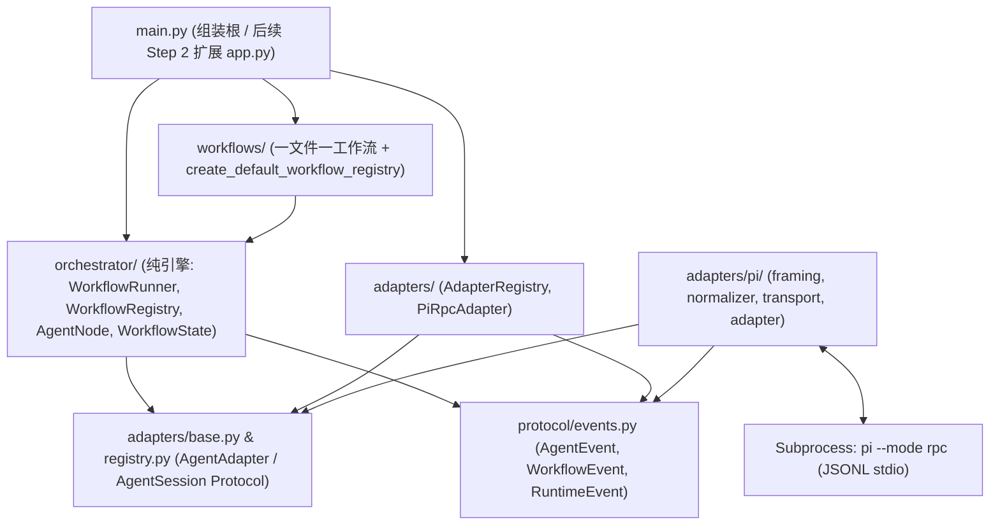
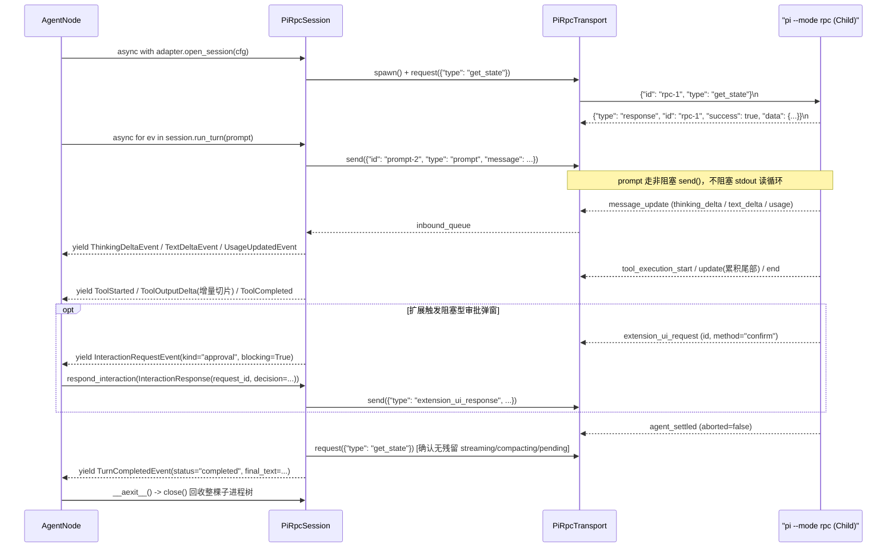
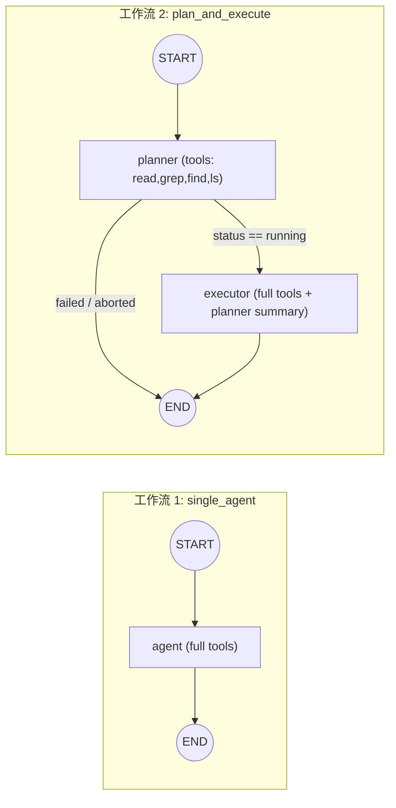

# CARE Agent Runtime 详细设计文档（Workflow + Agent）

> **文档状态**：已落地（Step 1 实现基线，对应 `services/agent-runtime` v0.0.1）  
> **关联文档**：[总体架构设计文档](./architecture.md)  
> **适用范围**：AI 工程（Python / LangGraph / Pi）、后端（Java 事件消费与契约对接）、前端（Electron / Web 流式渲染）

---

## 1. 设计目标与职责边界

`services/agent-runtime` 是 CARE 系统的同构 AI 编排与执行运行时。本文档聚焦其核心执行引擎——**“宏观 LangGraph 编排 + 微观 `AgentAdapter` (`pi --mode rpc`) 执行”**双层架构的详细设计。

### 1.1 核心设计目标

1. **编排与执行彻底解耦**：LangGraph 只负责工作流状态机、节点拓扑、结构化交接与 Checkpoint 持久化；单节点原子执行（读文件、改代码、跑终端、工具循环）完全交给可插拔的 `AgentAdapter`。
2. **统一事件流契约**：无论底层接入 `pi` 还是后续的 Codex CLI / Claude Code，对外都归一化为强类型的 `RuntimeEvent` 序列（含单调递增 `seq`），为后续导出跨语言 `contracts/canonical-event.schema.json` 奠定真实基线。
3. **节点间上下文防膨胀**：高频流式增量只走实时事件通道，LangGraph `WorkflowState` 与 SQLite Checkpointer 仅持久化紧凑的节点结构化交接摘要（`NodeOutput`）。
4. **代码优先的工作流编排**：工作流直接用 Python + LangGraph 原生 `StateGraph` 编写，充分利用类型检查、条件边与循环能力，不引入受限的 JSON/YAML 编排 DSL。
5. **默认 Fail-Fast**：协议违规、非法 JSON、缺失配置、上游节点失败都在第一时间显式暴露并短路，绝不静默吞错或带着错误结果进入下游节点。

---

## 2. 模块分层与代码结构

### 2.1 分层依赖关系

运行时内部采用严格单向分层，**`protocol/` 与 `orchestrator/` 对 `pi` 零直接依赖**：



### 2.2 目录与文件职责

```text
services/agent-runtime/
├── pyproject.toml                         # Python >=3.14, 轻量依赖 (langgraph, checkpoint-sqlite, pydantic)
├── main.py                                # 直接右键运行的 main() 入口（直接配置参数并流式查看事件）
├── src/agent_runtime/
│   ├── paths.py                           # 本地 CARE 目录路径约定 (~/.care/settings.json, ~/.care/tmp，支持 CARE_HOME 覆盖)
│   ├── config.py                          # 本地配置加载/持久化 (~/.care/settings.json)
│   ├── protocol/
│   │   └── events.py                      # AgentEvent / WorkflowEvent / RuntimeEvent / AgentFailure / 凭据脱敏
│   ├── adapters/
│   │   ├── base.py                        # AgentAdapter / AgentSession Protocol, ModelEndpoint, SessionConfig, AgentCapabilities
│   │   ├── errors.py                      # AdapterError 分层异常体系
│   │   ├── registry.py                    # 显式 AdapterRegistry 容器
│   │   └── pi/
│   │       ├── framing.py                 # 严格 LF-only 字节分帧器 (JsonlFramer)
│   │       ├── normalizer.py              # 无 I/O 的 Pi 原生事件归一化状态机 (PiEventNormalizer)
│   │       ├── transport.py               # 子进程生命周期、隔离 models.json/环境变量注入与跨平台进程树回收 (PiRpcTransport)
│   │       └── adapter.py                 # PiRpcAdapter & PiRpcSession 实现
│   ├── orchestrator/                      # 【纯执行引擎，不感知具体业务工作流】
│   │   ├── state.py                       # 防膨胀 WorkflowState & NodeOutput
│   │   ├── node.py                        # 通用 AgentNode 工厂 (build_agent_node), continue_if_running, RunContext
│   │   ├── registry.py                    # WorkflowDefinition & WorkflowRegistry（与 AdapterRegistry 对称）
│   │   └── runner.py                      # 生产总入口 WorkflowRunner (AsyncSqliteSaver + 流式定序)
│   └── workflows/                         # 【具体业务工作流集合，一文件一工作流，彼此互不依赖】
│       ├── __init__.py                    # BUILTIN_WORKFLOWS 与 create_default_workflow_registry() 显式注册
│       ├── single_agent.py                # SINGLE_AGENT_WORKFLOW (START -> agent -> END)
│       └── plan_and_execute.py            # PLAN_AND_EXECUTE_WORKFLOW (planner -> executor -> END)
└── tests/
    ├── fakes/fake_pi_rpc.py               # 独立子进程 Fake Pi RPC 协议替身（外部边界注入）
    ├── e2e/test_workflow_scenarios.py     # 生产路径全链路端到端场景测试
    └── unit/
        ├── test_config.py                 # ModelEndpoint 与 ~/.care/settings.json 失败模式测试
        ├── test_framing.py                # JsonlFramer 失败模式隔离测试
        └── test_normalizer.py             # PiEventNormalizer 失败模式隔离测试
```

---

## 3. 统一事件模型设计（`protocol/`）

### 3.1 两层分离 + 统一信封

`AgentAdapter` 只感知单个原子 Agent 的 Turn 生命周期，不感知工作流 ID、节点 ID 和全局序号；`WorkflowRunner` 负责在最外层补充编排上下文与单调序号 `seq`。因此事件拆为两层并由统一信封封装：

```python
class RuntimeEvent(BaseModel, frozen=True):
    seq: int                        # 单次 run 内从 1 开始严格递增，用于断点续传与排序
    timestamp: datetime             # UTC 时间戳
    run_id: str                     # 本次工作流运行实例 ID
    workflow_id: str                # 预设或自定义工作流名称
    node_id: str | None = None      # 节点内事件带节点 ID，工作流级事件为 None
    payload: AgentEvent | WorkflowEvent  # Pydantic v2 Discriminated Union (discriminator="type")

    @property
    def is_ephemeral(self) -> bool:
        return self.payload.type in EPHEMERAL_EVENT_TYPES
```

### 3.2 双通道分离：持久化生命周期 vs 瞬时流式增量

借鉴生产级流式运行时经验，将事件明确划分为两类（由 `EPHEMERAL_EVENT_TYPES` 确定性判定，无需在协议中冗余传参）：

- **瞬时流式增量（`is_ephemeral == True`）**：`text.delta`、`thinking.delta`、`tool.output_delta`。仅通过 LangGraph `stream_mode="custom"` 实时推送给客户端渲染，**不写入 `WorkflowState` 和 Checkpoint**，避免长 Turn 导致 $O(N^2)$ 序列化膨胀。
- **权威状态与生命周期事件（`is_ephemeral == False`）**：完整消息终稿、工具起止与结果、压缩/重试、交互请求、Turn/Node/Workflow 起止与终态，适合落 Event Log、审计与重放。

### 3.3 事件类型清单

| 归属层 | `type` | 瞬时 | 核心字段 | 语义说明 |
| :--- | :--- | :---: | :--- | :--- |
| **Agent** | `turn.started` | 否 | `turn_id`, `session_id` | 原子 Agent 开始执行一轮 Turn |
| **Agent** | `text.delta` | 是 | `delta`, `content_index` | 助手正文增量切片 |
| **Agent** | `thinking.delta` | 是 | `delta`, `content_index` | 模型思考过程增量切片 |
| **Agent** | `message.completed` | 否 | `role`, `text`, `thinking`, `model`, `usage` | 单条消息权威终稿 |
| **Agent** | `tool.started` | 否 | `tool_call_id`, `tool_name`, `arguments`, `parent_tool_call_id` | 工具开始执行 |
| **Agent** | `tool.output_delta` | 是 | `tool_call_id`, `tool_name`, `chunk` | 工具流式增量输出（已去重切片） |
| **Agent** | `tool.completed` | 否 | `tool_call_id`, `tool_name`, `output`, `is_error`, `duration_ms` | 工具执行结束与耗时 |
| **Agent** | `compaction` | 否 | `phase(started\|completed)`, `reason`, `summary` | 上下文自动/手动压缩生命周期 |
| **Agent** | `retry` | 否 | `phase(started\|completed)`, `attempt`, `max_attempts`, `error`, `succeeded` | 底层自动重试状态 |
| **Agent** | `interaction.request` | 否 | `request_id`, `kind(approval\|user_input\|notify)`, `blocking`, `title`, `message`, `tool_call_id`, `tool_name`, `arguments`, `input_mode`, `options` | 后端无关的人机交互/工具审批请求（统一兼容 Pi 扩展弹窗、Claude `canUseTool`/`AskUserQuestion`、Codex/ACP 工具审批） |
| **Agent** | `usage.updated` | 否 | `usage(TokenUsage)` | 实时 Token 用量更新 |
| **Agent** | `turn.completed` | 否 | `turn_id`, `status(completed\|aborted\|failed)`, `final_text`, `usage`, `failure`, `session_reusable` | Turn 权威终态，显式告知会话是否可复用 |
| **Workflow** | `workflow.started` | 否 | `preset`, `prompt` | 工作流开始执行 |
| **Workflow** | `node.started` | 否 | `node_id`, `role`, `adapter` | LangGraph 某个 Agent 节点开始执行 |
| **Workflow** | `node.completed` | 否 | `node_id`, `role`, `status`, `summary`, `usage`, `failure` | 节点执行结束与结构化交接摘要 |
| **Workflow** | `workflow.completed` | 否 | `status(completed\|failed\|aborted)`, `final_output`, `failure` | 工作流最终状态与汇总产出 |

### 3.4 结构化失败分类与凭据脱敏

所有业务/传输错误统一归类为 `AgentFailure(failure_class, message, code, retryable)`：
- `failure_class` 取值：`usage_limit`、`permission_error`、`provider_error`、`transport_error`、`protocol_error`、`unknown`；
- `AgentFailure.from_raw()` 强制经过 `redact_sensitive_text()`：遮蔽 `Bearer/Basic` 凭据、URL 中的 `user:pass@`、`sk-...` 系列 API Key 及 JSON 敏感字段，剔除控制字符并限制最大长度 4096 字符，防止密钥经错误事件或日志外泄。

---

## 4. `AgentAdapter` 抽象设计（`adapters/`）

### 4.1 协议契约

采用 **“会话上下文管理器（`open_session`） + 极薄 `AgentSession` 协议”**，同时适配单 Agent 多轮对话与多 Agent 节点级子进程隔离：

```python
class AgentCapabilities(BaseModel, frozen=True):
    streaming: bool = True
    steering: bool = False       # 运行中实时纠偏
    follow_up: bool = False      # 队列追加指令
    abort: bool = False          # 主动中止
    session_resume: bool = False # 基于 session_ref 断点恢复
    interactions: bool = False   # 双向工具审批 / 用户提问交互

class AgentSession(Protocol):
    @property
    def session_id(self) -> str | None: ...
    @property
    def session_ref(self) -> str | None: ...   # 持久化会话文件/外部句柄，未持久化时为 None
    def run_turn(self, prompt: str) -> AsyncIterator[AgentEvent]: ...
    async def steer(self, message: str) -> None: ...
    async def follow_up(self, message: str) -> None: ...
    async def abort(self) -> None: ...
    async def respond_interaction(self, response: InteractionResponse) -> None: ...
    async def close(self) -> None: ...

class AgentAdapter(Protocol):
    kind: str
    capabilities: AgentCapabilities
    def open_session(self, config: SessionConfig) -> AbstractAsyncContextManager[AgentSession]: ...
```

### 4.2 模型端点配置、本地 `~/.care/` 与异常边界

- **`ModelEndpoint`（`adapters/base.py`）与本地配置（`config.py`）**：
  - 核心引擎层（`WorkflowRunner` / `AgentNodeConfig` / `SessionConfig`）只接收内存中的 `ModelEndpoint(model, provider, base_url, api_protocol, api_key: SecretStr)`，不强绑定本地文件路径，也不将 `api_key` 写入 `WorkflowState`、Checkpoint 或 `RuntimeEvent`；
  - 本地入口默认读取 `~/.care/settings.json`（支持 `CARE_HOME` 环境变量覆盖，支持多 Profile 切换与 `active_profile`，写入时采用原子替换与 `0600` 权限）；
  - 当传入自定义 `base_url` 或 `api_key` 时，`PiRpcTransport` 在 `~/.care/tmp/care-pi-*`（按会话隔离的临时目录，支持 `CARE_HOME` 覆盖）生成 `models.json`（使用 `"apiKey": "$CARE_LLM_API_KEY"` 引用，无明文落盘），通过子进程环境变量注入 `PI_CODING_AGENT_DIR` 与 `CARE_LLM_API_KEY`，避免污染宿主机 `~/.pi/agent` 且天然支持多节点/多任务并发隔离，会话结束自动清理。
- **`ModelEndpoint` / `SessionConfig` 构造期 fail-fast 校验**：
  - `model` 不可为空；传入 `base_url` 时须为 `http://` 或 `https://`；未指定 `base_url` 而传入 `api_key` 时必须同时指定内置 `provider`；
  - `no_tools=True` 与显式 `tools=(...)` 互斥；
  - 传入 `session_ref` 恢复会话时必须设置 `persist_session=True`。
- **异常分层（`adapters/errors.py`）**：
  - `AdapterStartupError`：二进制未找到、工作目录不存在或握手失败；
  - `AdapterTransportError`：子进程异常退出、管道断开或控制 RPC 超时；
  - `AdapterProtocolError`：对端输出违反线协议（非 JSON、超长帧、缺少必填字段）；
  - `AdapterRpcError`：后端显式拒绝控制指令（携带脱敏后的错误详情）。

### 4.3 接入新 Agent 后端的方法

未来接入 Codex CLI、Claude Code 或 ACP Agent 时，只需三步且**无需修改 `orchestrator/`**：
1. 在 `src/agent_runtime/adapters/<backend>/` 实现 `AgentAdapter` 与 `AgentSession`；
2. 在组装根将新实例注册到 `AdapterRegistry({"pi": ..., "codex": ...})`；
3. 在 LangGraph 节点的 `AgentNodeConfig(adapter="codex", ...)` 中按节点粒度指定后端，即可实现同一工作流内多 Agent 混编。

---

## 5. `PiRpcAdapter` 详细设计（`adapters/pi/`）

### 5.1 为何选择 `pi --mode rpc`

| 模式 | 能力 | 结论 |
| :--- | :--- | :--- |
| `--print` / `-p` | 单轮非交互纯文本 | 不支持结构化事件与工具观测 |
| `--mode json` | 单轮 JSONL 事件流，结束即退出 | 无法运行中 `steer` / `followUp` / `abort` / `get_state`，无法回传 `extension_ui_response` 做工具级审批 |
| TypeScript `RpcClient` | Node/TS 进程内封装 | 无法直接融入 Python LangGraph 运行时 |
| **`--mode rpc`** | 长生命周期、有状态、双向 `stdin`/`stdout` JSONL 协议 | **唯一同时满足跨语言子进程隔离、实时流、运行中干预、状态探测与审批桥接的模式** |

### 5.2 单轮 Turn 交互时序



### 5.3 Pi 原生事件 → `AgentEvent` 映射表

| Pi 原生 `JsonAgentSessionEvent` | 归一化处理逻辑（`normalizer.py` / `adapter.py`） | 产出 `AgentEvent` |
| :--- | :--- | :--- |
| `message_update` (`usage`) | 兼容 `inputTokens`/`outputTokens` 与 `input+cacheRead+cacheWrite`/`output` 两种格式 | `UsageUpdatedEvent` |
| `message_update` (`thinking_delta` / `text_delta`) | 透传增量切片并记录流式文本备用 | `ThinkingDeltaEvent` / `TextDeltaEvent` |
| `message_end` (`assistant` / `user`) | 拼接 `content` 数组内的 `text` / `thinking` 权威内容；若 `assistant` 且 `stopReason="error"` 则记录脱敏分类后的 `AgentFailure` | `MessageCompletedEvent` |
| `tool_execution_start` | 记录初始空输出缓冲并提取 `args`、`parentToolCallId` | `ToolStartedEvent` |
| `tool_execution_update` | 与上次已推送文本做前缀切片或 KMP 最长后缀-前缀重叠计算，仅发新增增量 | `ToolOutputDeltaEvent` |
| `tool_execution_end` | 提取结果文本、`isError`、`durationMs` 并清理该工具缓冲 | `ToolCompletedEvent` |
| `compaction_start` / `compaction_end` | 更新会话 `is_compacting` 状态 | `CompactionEvent` |
| `auto_retry_start` / `auto_retry_end` | 重试成功（`success=true`）时清空瞬态 `failure`；失败则记录终态错误 | `RetryEvent` |
| `extension_ui_request` | `confirm` → `kind="approval"`；`select`/`input`/`editor` → `kind="user_input"`；`notify` → `kind="notify", blocking=False`；纯 TUI 装饰（`setStatus`/`setWidget` 等）忽略 | `InteractionRequestEvent` |
| `extension_error` | 记录脱敏后的 `provider_error` | （汇聚至 `TurnCompletedEvent.failure`） |
| `agent_settled` | 结合 `get_state` 二次确认空闲后汇总状态、文本、用量与错误 | `TurnCompletedEvent` |

### 5.4 关键工程避坑设计

1. **严格 `\n` 字节分帧 + Fail-Fast（`framing.py`）**：
   - 严禁使用 `str.splitlines()`，防止 JSON 字符串中的 Unicode 行分隔符 `U+2028`/`U+2029` 破坏帧边界；
   - 逐 chunk 累积字节时实时校验 `max_line_bytes`（默认 16 MiB），超限前即截断报错防 OOM；
   - 遇到空行、非法 UTF-8、非 JSON 文本、非 JSON Object 或 EOF 截断帧，立即抛 `AdapterProtocolError`，绝不静默丢弃。
2. **控制 RPC 与非阻塞 `prompt` 通道分离（`transport.py` & `adapter.py`）**：
   - `get_state`、`clear_queue`、`abort` 通过 `id -> asyncio.Future` 同步关联（带超时）；
   - `prompt`、`steer`、`follow_up`、`extension_ui_response` 走非阻塞 `send()`，其响应通过 `inbound_queue` 统一消费，彻底消除“扩展处理 `prompt` 时弹窗等待 `extension_ui_response`”导致的互锁。
3. **以 `agent_settled` + `get_state` 为 Turn 终态**：
   - `agent_end` 仅表示单次模型循环结束，后续仍可能触发自动重试或压缩；收到 `agent_settled` 后再调用一次 `get_state` 确认 `isStreaming=false && isCompacting=false && pendingMessageCount==0` 才结案。
4. **队列清理与压缩竞态处理**：
   - `abort()` 严格先发 `clear_queue` 再发 `abort`，避免 Pi 取消当前 Turn 后立刻执行队列中残留消息；
   - 若提交 `prompt` 时 Pi 正处于压缩期（或返回包含 `compaction` 的拒收响应），会话自动等待 `compaction_end` 后重发一次。
5. **KMP 滑动窗口增量 Diff（`normalizer.py`）**：
   - Pi 对 `bash` 等长输出工具的 `tool_execution_update` 会反复回传完整尾部（且超长时会丢弃头部滚动窗口）；常规增长走 $O(1)$ 前缀切片，窗口滚动时走 $O(N)$ KMP 最长后缀-前缀重叠匹配，既不重复发旧行，也不因窗口平移丢失新行。
6. **Windows / POSIX 跨平台子进程与参数安全（`transport.py`）**：
   - **临时文件透传 Prompt**：将 `--system-prompt` / `--append-system-prompt` 写入会话级 `TemporaryDirectory`，传文件路径给 Pi，彻底避免 Windows `cmd.exe`（经 `pi.cmd` 包装时）截断多行文本或误解析 `& | % ^` 元字符；
   - **二进制解析**：先查显式路径与 `PATH`，若解析默认 `pi` 失败则检查官方安装目录 `~/.pi/agent/bin/pi.cmd`（Windows）/ `~/.pi/agent/bin/pi`（POSIX），仍不存在则立即抛 `AdapterStartupError`；
   - **进程树清理**：保持 `stdin` 开启直至主动 `close()`；Windows 调用 `taskkill /PID <pid> /T /F` 回收 `cmd.exe` + `node.exe` + 工具子进程整棵树，POSIX 使用 `start_new_session=True` + `os.killpg`（`SIGTERM` 宽限 1s → `SIGKILL`）；
   - **Stderr 有界排空**：独立协程持续排空 `stderr` 到 16 KiB 环形缓冲，防止子进程因管道满阻塞；异常退出时将脱敏后的尾部诊断信息附入 `AdapterTransportError`。

---

## 6. LangGraph 编排层设计（`orchestrator/`）

### 6.1 防膨胀状态模型（`state.py`）

```python
class NodeOutput(BaseModel, frozen=True):
    node_id: str
    role: str
    status: Literal["completed", "failed", "aborted"]
    summary: str                   # 供下游节点消费的结构化交接文本
    session_ref: str | None = None # 若开启持久化会话，记录会话文件引用
    usage: TokenUsage | None = None
    failure: AgentFailure | None = None

class WorkflowState(TypedDict):
    run_id: str
    workflow_id: str
    prompt: str
    workspace_dir: str
    node_outputs: Annotated[dict[str, NodeOutput], merge_node_outputs]
    latest_output: str
    status: Literal["running", "completed", "failed", "aborted"]
    failure: AgentFailure | None
```

- 每个新节点都在独立干净的 Agent 会话中启动，只通过 `prompt_builder(state)` 按需读取 `prompt` 与上游 `node_outputs[...].summary`，避免上下文无限增长。
- 所有状态字段均为基础类型与 Pydantic v2 模型，与 `langgraph-checkpoint-sqlite` 的 `JsonPlusSerializer` 在 Python 3.14 下原生兼容。

### 6.2 通用 `AgentNode` 生命周期（`node.py`）

`build_agent_node(node_config, run_context)` 将任意 `AgentNodeConfig` 封装为标准的 LangGraph 异步节点：
1. **短路守卫**：若 `state["status"] != "running"`，直接跳过执行；
2. **实时流透传**：通过 `langgraph.config.get_stream_writer()` 发射 `StreamPacket(node_id, event)`，将 `node.started`、全部 `AgentEvent` 和 `node.completed` 零缓冲实时推给 `WorkflowRunner`；
3. **运行中干预注册**：在 `async with adapter.open_session(...) as session:` 期间将活跃会话登记到 `RunContext.active_sessions[run_id]`，并在 `finally` 中安全注销，支撑外部 `runner.steer(run_id, ...)` / `runner.follow_up(run_id, ...)` / `runner.abort(run_id)`；
4. **阻塞型交互/审批处理**：若收到 `InteractionRequestEvent(blocking=True)`，有注册 `interaction_handler` 时异步回调获取 `InteractionResponse`（`decision: approve|deny|cancel`、`feedback`、`value`）并回传；无头模式下立即回复 `InteractionResponse(decision="cancel")` 防止子进程永久挂起；
5. **状态写回**：产出紧凑 `NodeOutput`，若 Turn 非 `completed`，将 `status` 切换为 `failed` / `aborted` 并写入 `failure`。

### 6.3 内置工作流与扩展规范（`workflows/` + `orchestrator/registry.py`）

工作流层与执行引擎层通过 `WorkflowRegistry` 解耦：
- 每个工作流独立放在 `src/agent_runtime/workflows/<name>.py`，导出一个自包含的 `WorkflowDefinition(name, description, build)`；
- 工作流模块只依赖 `orchestrator/` 提供的原语，工作流之间**互不 import**；单个工作流代码长大后可直接从 `<name>.py` 升级为同名子包 `<name>/`，对外路径不变；
- 所有内置工作流在 `workflows/__init__.py` 中显式注册到 `create_default_workflow_registry()`（不做动态目录扫描黑魔法，重名立即 fail-fast），由组装根与 `AdapterRegistry` 对称注入 `WorkflowRunner(adapter_registry, workflow_registry)`。



1. **`single_agent`**（`workflows/single_agent.py`）：1 节点通用图，对应总体架构中的 `SingleVibeGraph`。
2. **`plan_and_execute`**（`workflows/plan_and_execute.py`）：2 节点串行图：
   - `planner` 通过 `--tools read,grep,find,ls` 从工具边界强制限制为只读，分析工作区并产出分步执行计划；
   - `continue_if_running("executor")` 条件边确保 `planner` 失败或中止时直接结束，不触发 `executor`；
   - `executor` 读取 `state["node_outputs"]["planner"].summary` 与原始 `prompt`，以全量工具执行计划并验证。

#### 如何新增工作流

新增 `src/agent_runtime/workflows/security_audit.py`，导出 `SECURITY_AUDIT_WORKFLOW` 并在 `workflows/__init__.py` 的 `BUILTIN_WORKFLOWS` 追加一行即可（`WorkflowRunner.run()` 也支持直接传入任意自定义 `WorkflowBuilder` 函数）：

```python
from langgraph.graph import END, START, StateGraph
from agent_runtime.orchestrator import (
    AgentNodeConfig, RunContext, WorkflowDefinition, WorkflowState,
    build_agent_node, continue_if_running,
)

def build_security_audit_workflow(
    run_context: RunContext, *, adapter="pi", **kwargs
) -> StateGraph[WorkflowState]:
    graph: StateGraph[WorkflowState] = StateGraph(WorkflowState)
    graph.add_node("analyst", build_agent_node(
        AgentNodeConfig(
            id="analyst",
            role="analyst",
            adapter=adapter,
            tools=("read", "grep", "find", "ls"),
            append_system_prompt="Analyze security risks only.",
            prompt_builder=lambda s: f"Audit: {s['prompt']}",
            **kwargs,
        ),
        run_context,
    ))
    graph.add_node("fixer", build_agent_node(
        AgentNodeConfig(
            id="fixer",
            role="fixer",
            adapter=adapter,
            prompt_builder=lambda s: f"Fix issues:\n{s['node_outputs']['analyst'].summary}",
            **kwargs,
        ),
        run_context,
    ))
    graph.add_edge(START, "analyst")
    graph.add_conditional_edges("analyst", continue_if_running("fixer"), {"fixer": "fixer", END: END})
    graph.add_edge("fixer", END)
    return graph

SECURITY_AUDIT_WORKFLOW = WorkflowDefinition(
    name="security_audit",
    description="Read-only security analyst followed by fixer.",
    build=build_security_audit_workflow,
)
```

### 6.4 `WorkflowRunner` 与 Checkpoint（`runner.py`）

- 采用 `async with WorkflowRunner(adapter_registry, workflow_registry, checkpoint_db=...) as runner:` 管理 `AsyncSqliteSaver` 生命周期（默认 `:memory:`，传文件路径则持久化到 SQLite，退出自动关闭 `aiosqlite` 连接）。
- 消费 `compiled.astream(initial_state, config={"configurable": {"thread_id": ...}}, stream_mode=["custom", "updates"], version="v2")`：
  - `custom` 通道实时包装节点内事件并分配单调递增 `seq`；
  - `updates` 通道追踪最终状态与产出，并在图执行完毕后统一发射 `WorkflowCompletedEvent`。
- 提供 `get_checkpoint_state(workflow, thread_id)` 直接读取已落盘的节点状态快照。

---

## 7. 测试与验证架构

遵循“端到端场景优先、替身止于外部边界、纯解析逻辑先列失败清单”的策略：

1. **外部边界协议替身（`tests/fakes/fake_pi_rpc.py`）**：
   - 独立子进程，通过真实 `stdin`/`stdout` 实现 `pi --mode rpc` JSONL 协议，仅经生产配置项 `PiRpcConfig(command=(sys.executable, ...))` 注入；
   - **生产代码零测试分支、零内部模块 Mock**，完整走通子进程拉起、LF 分帧、请求 ID 关联、事件归一化、LangGraph 状态图与 SQLite Checkpoint。
2. **全链路 E2E 场景（`tests/e2e/test_workflow_scenarios.py`）**：
   - 覆盖 `single_agent` 流式 + Checkpoint、`plan_and_execute` 跨节点交接与工具隔离、阻塞型 `interaction.request` 审批（有/无 handler）、运行中 `steer` 与 `abort`（验证 `clear_queue -> abort` 顺序）、上游失败短路与密钥脱敏、Compaction 竞态重发、非法 stdout fail-fast、子进程中途崩溃（exit 137），以及从 `~/.care/settings.json` 持久化/加载到 `PiRpcTransport` 隔离 `models.json` 与子进程密钥注入（验证命令行、临时文件、事件流与 Checkpoint 均零明文泄漏）；
   - 将事件流归一化为确定性 `manifest.json`（剥离时间戳等易变字段）进行断言。
3. **失败模式隔离测试（`tests/unit/`）**：
   - `test_config.py`（13 项）：缺失配置默认值、`CARE_HOME` 覆盖、原子保存/`0600` 权限与内存掩码、兼容桌面端扩展字段，以及非法 JSON / 悬空 `active_profile` / 非法 `ModelEndpoint` 组合的 fail-fast；
   - `test_framing.py`（12 项）：多字节 UTF-8 跨块切分、CRLF、`U+2028/U+2029`、边界行长、空行、非法 UTF-8/JSON/非对象与 EOF 截断；
   - `test_normalizer.py`（7 项）：双格式 Usage、多块消息、工具输出前缀增长/重复帧/滑动窗口重叠 Diff、凭据脱敏与限流分类、压缩与重试恢复、UI 弹窗分类与协议缺字段 fail-fast。
4. **实机冒烟入口（`main.py`）**：
   - 模型 / Base URL / API Key 默认读取 `~/.care/settings.json`（可通过 `CARE_HOME` 覆盖），在 IDE 中直接打开 `services/agent-runtime/main.py` 修改 `prompt` / `workflow` / `profile` / `cwd` 等参数后右键直接运行即可（或在目录内执行 `uv run python main.py`）。

---

## 8. 后续演进衔接（Step 2+）

当前实现已为总体架构的后续阶段留好干净接缝，演进时无需推倒重来：

| 后续阶段 | 演进内容 | 与当前代码的衔接点 |
| :--- | :--- | :--- |
| **Step 2（服务化与契约导出）** | 导出 `contracts/canonical-event.schema.json`；新增 `app.py` 暴露 FastAPI HTTP / SSE / WebSocket 接口 | 直接调用 `RuntimeEvent.model_json_schema()`；FastAPI 路由直接透传 `WorkflowRunner.run()` 产出的 `RuntimeEvent` 及 `steer`/`follow_up`/`abort` 控制方法 |
| **Step 3（双层 HITL 审批）** | 节点间人工审批（LangGraph `interrupt()`）与工具级拦截（`packages/pi-extensions/enterprise-approval-gate`） | 节点级通过 `Command(resume=...)` 复用 `AsyncSqliteSaver`；工具级扩展经 `SessionConfig.extensions` 注入，审批与提问统一走已实现的 `InteractionRequestEvent` + `interaction_handler` + `respond_interaction()` |
| **Step 4（云端模式与多后端）** | 云端沙箱持久化与多 Agent 后端混编 | `WorkflowRunner` 切换 `AsyncPostgresSaver`（`MODE=cloud`）；`AdapterRegistry` 注册第二个 `AgentAdapter`（Codex / Claude Code） |
