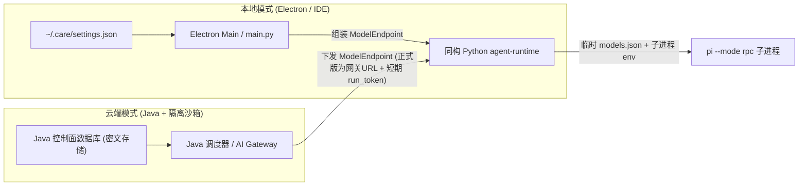
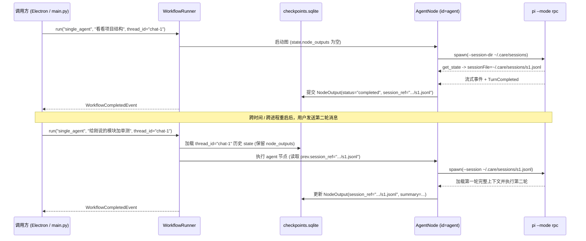
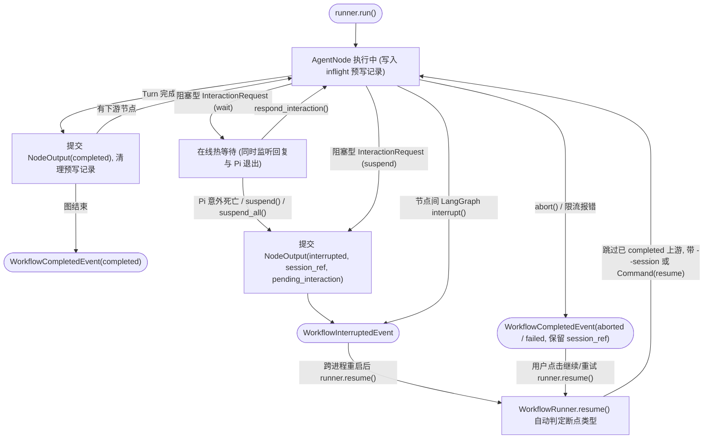

# CARE Agent Runtime 配置体系、连续对话与双层中断恢复设计文档

> **文档状态**：已落地（本地 `~/.care/` 配置、Step A 连续对话与 Step B 双层中断恢复均已实现并通过验证）  
> **关联文档**：[总体架构设计文档](../architecture.md) · [Agent Runtime 核心设计文档](agent-runtime-design.md)  
> **适用范围**：AI 工程（Python / LangGraph / Pi）、桌面端（Electron）、后端（Java 控制面与 AI Gateway）

---

## 1. 背景与设计目标

在完成 Step 1 单次工作流执行基线后，CARE 走向本地打包（Electron Sidecar）与企业云端双模运行时，需要系统性解决四个核心问题：

1. **模型与密钥配置同构**：既支持本地用户在 Electron 设置页直接配置自定义 Base URL、API Key 与模型（BYOK），又能在云端无缝切换为企业统一 AI Gateway，做到 **`agent-runtime` 核心代码零环境分支**。
2. **连续多轮对话（Vibe Coding 体验）**：同一会话线程（`thread_id`）支持连续多轮交互、跨进程重启不丢上下文，同时严格保持多节点工作流内各节点间的上下文隔离。
3. **双层中断与恢复（Workflow + Agent 联动）**：不仅支持 Workflow 节点间主动挂起（如 LangGraph `interrupt()`），还完整支持 **Agent 节点内部** 的权限审批、`ask_question` 提问、运行中 `abort` 与限流/崩溃恢复；被中断的节点恢复完成后，Workflow 必须自动继续执行后续下游节点。
4. **热交互极端故障兜底**：在等待用户审批或回答问题的在线热交互期间，面对 **Pi 子进程被杀**、**用户正常关闭软件** 以及 **极端强杀（`kill -9` / 断电）**，都能确保不卡死、不丢对话历史、重启即可还原现场继续执行。

---

## 2. 本地 `~/.care/` 目录体系与双模配置架构

### 2.1 统一本地目录布局

为兼容 macOS / Windows / Linux 跨平台打包与开发者排错，本地数据统一收口在用户主目录 `~/.care/` 下，并通过环境变量 **`CARE_HOME`** 支持整体路径覆盖（用于多套配置切换、CI 与测试隔离）：

```text
~/.care/
├── settings.json        # [已落地] 本地模型配置与偏好唯一真相源（POSIX 0600）
├── tmp/                 # [已落地] 单次 Pi 子进程瞬态运行目录 care-pi-*（退出即清理）
├── sessions/            # [已落地] Pi 持久化对话历史 .jsonl（--session-dir 指向此目录）
└── checkpoints.sqlite   # [已落地] LangGraph Checkpointer 与预写恢复表
```

目录职责严格分离（由 `src/agent_runtime/paths.py` 统一管理，避免循环依赖）：

| 目录 / 文件 | 生命周期 | 职责说明 |
| :--- | :--- | :--- |
| `~/.care/settings.json` | 持久 | 存放多套模型 Profile、当前激活 Profile（`active_profile`）及可选 `pi_bin`；支持 Electron 写入额外 UI 字段（`extra="ignore"`）。 |
| `~/.care/tmp/care-pi-*` | 瞬态（随子进程销毁） | 存放单次会话专属的 `models.json`、`system_prompt.txt`、`append_system_prompt.txt`；保证并发多任务/多节点使用不同网关时互不覆盖。 |
| `~/.care/sessions/` | 持久 | 经 Pi 原生 `--session-dir` 传入，集中保存所有节点产生的 `.jsonl` 对话树，与 `tmp/` 彻底解耦，永不随子进程退出被误删。 |
| `~/.care/checkpoints.sqlite` | 持久 | 存放 LangGraph `AsyncSqliteSaver` 工作流断点及轻量预写表 `care_inflight_nodes`。 |

### 2.2 本地配置格式（`~/.care/settings.json`）

本地模式下不引入额外加密存储层，直接以明文 JSON 落盘并采用 **同目录临时文件 + `chmod 0600` + `os.replace` 原子替换** 防止写入中途损坏。

```json
{
  "active_profile": "deepseek",
  "pi_bin": null,
  "profiles": {
    "deepseek": {
      "model": "deepseek-chat",
      "base_url": "https://api.deepseek.com/v1",
      "api_key": "sk-your-key",
      "api_protocol": "openai-completions",
      "thinking_level": null
    },
    "claude-relay": {
      "model": "claude-sonnet-4-5",
      "base_url": "https://relay.example.com",
      "api_key": "sk-ant-your-key",
      "api_protocol": "anthropic-messages",
      "thinking_level": "medium"
    },
    "ollama": {
      "model": "qwen2.5-coder:7b",
      "base_url": "http://localhost:11434/v1",
      "api_protocol": "openai-completions"
    }
  }
}
```

### 2.3 本地模式与云端模式配置方案对比

核心原则：**配置存储归属各自的控制面，`agent-runtime` 引擎层永远只消费内存中的 `ModelEndpoint`，不绑定文件也不直连数据库。**



云端模型配置的三种方案权衡与最终选型：

| 云端方案 | 结论 | 核心原因 |
| :--- | :--- | :--- |
| **存放在个人/团队工作区目录内** | **禁止** | Agent 在工作区拥有 `read`/`grep`/`bash` 权限，极易因 Prompt Injection 或 `git add .` 泄露密钥；且破坏会话流转（Transfer/Fork）与组内共享工作区隔离。 |
| **存数据库 + 建沙箱时静态生成 `settings.json`** | **不推荐** | 明文落盘在沙箱文件系统内仍可被 `bash` 读取；不利于用户中途切换模型，也阻碍 Warm Pool 容器预热复用。 |
| **存 Java 数据库 + 运行时动态下发 → 演进至 AI Gateway** | **推荐** | 真相源在 Java 控制面数据库（密文存储）。MVP 阶段发起 `/runs` 时经请求体内存下发 `ModelEndpoint`；正式版切换为 `base_url = 企业网关地址` + `api_key = 绑定 run_id 的短期令牌`，实现 **沙箱内零真实上游 API Key**，且 Python 运行时与前端代码零改动。 |

### 2.4 后端无关 `ModelEndpoint` 与 Pi 隔离注入机制（已落地）

1. **`ModelEndpoint` 值对象（`adapters/base.py`）**：
   - 字段：`model`、`provider`、`base_url`、`api_protocol`（`openai-completions` / `openai-responses` / `anthropic-messages` / `google-generative-ai`）、`api_key: SecretStr | None`。
   - **安全红线**：`api_key` 在内存中以 Pydantic `SecretStr` 持有（`repr` 与默认 JSON 序列化自动掩码），且 **严禁写入** `WorkflowState`、SQLite Checkpoint 和 `RuntimeEvent`。
2. **`PiRpcTransport` 按会话隔离注入（`adapters/pi/transport.py`）**：
   - 仅当 `endpoint` 含自定义 `base_url` 或 `api_key` 时，在 `~/.care/tmp/care-pi-*/` 内写入独立 `models.json`，并通过子进程环境变量注入 `PI_CODING_AGENT_DIR` 与 `CARE_LLM_API_KEY`；
   - **密钥不落盘、不进命令行**：`models.json` 中只写 `"apiKey": "$CARE_LLM_API_KEY"`（利用 Pi 原生环境变量插值），绝不通过 `--api-key` 暴露给 `ps`；
   - **三类端点精准适配**：
     - **自定义中转站 / 网关**（有 `base_url` + `api_key`）：写入 `baseUrl`、`api`、`apiKey: "$CARE_LLM_API_KEY"` 与 `models` 列表；
     - **本地无鉴权模型（如 Ollama）**（仅 `base_url` 无 `api_key`）：写入占位 `"apiKey": "no-key"`（满足 Pi 认证判定），并清理父进程残留的 `CARE_LLM_API_KEY`；
     - **官方内置 Provider 仅换 Key**（仅 `provider` + `api_key`）：`models.json` 仅覆写该 `provider` 的 `apiKey`，保留 Pi 内置官方 URL、上下文窗口与计价元数据；
   - **避免误发推理参数**：仅当 `thinking_level not in (None, "off")` 时才将自定义模型的 `"reasoning"` 设为 `true`，防止不支持推理参数的普通模型被 Pi 默认附带 `reasoning_effort` 报错；
   - **不污染宿主机**：隔离 `PI_CODING_AGENT_DIR` 内无旧 `auth.json`，彻底避免被宿主机 `~/.pi/agent/auth.json` 按优先级静默覆盖。

---

## 3. 连续多轮对话与会话持久化设计（Step A）

### 3.1 宏观与微观双层持久化分工

| 持久化层级 | 存储介质 | 关联键 | 持久化内容 |
| :--- | :--- | :--- | :--- |
| **宏观（Workflow 编排层）** | `~/.care/checkpoints.sqlite`（LangGraph `AsyncSqliteSaver`） | `thread_id` | 图执行进度、节点结构化交接摘要 `NodeOutput`（含 `session_ref`）、失败与挂起状态。 |
| **微观（Agent 对话层）** | `~/.care/sessions/<id>.jsonl`（Pi 原生会话树） | `session_ref`（文件路径） | 单个节点内完整的消息历史、思考过程、工具调用与输出上下文。 |

**严格边界约束**：
- 多节点工作流中，**每个节点按 `node_id` 独立维护各自的 `session_ref`**（例如 `planner` 与 `executor` 各自拥有独立的 Pi 会话文件，绝不共享同一份对话树），确保节点间上下文不膨胀。
- 内置工作流（`single_agent`、`plan_and_execute`）**默认开启 `persist_session=True`**（支持显式传参关闭）。

### 3.2 `PiRpcTransport` 会话目录解耦

在 `build_pi_argv()` 中补齐 `--session-dir` 透传逻辑：
- 当 `session_config.session_ref` 非空：传 `--session <session_ref>` 恢复既有会话；
- 否则当 `session_config.persist_session` 为 `True`：自动创建 `~/.care/sessions/`（受 `CARE_HOME` 控制）并传 `--session-dir <sessions_dir>`；
- 否则（`persist_session=False`）：传 `--no-session`。

这样即使 `PI_CODING_AGENT_DIR` 指向 `~/.care/tmp/care-pi-*`，Pi 生成的 `.jsonl` 对话文件也会持久写入 `~/.care/sessions/`，子进程退出清理 `runtime_dir` 时毫发无损。

### 3.3 同 `thread_id` 连续多轮对话时序



### 3.4 冷恢复底座与后续热会话演进

- **Step A 先做冷恢复底座**：每轮结束关闭 Pi 子进程，下轮通过 `--session <session_ref>` 恢复。优点是无常驻进程泄漏、重启电脑或迁移到云端沙箱 100% 一致。
- **后续桌面端热优化（可选）**：接入 Electron 后若对 ~300ms 进程冷启动敏感，可在 `PiRpcAdapter` 内部按 `session_ref` 加一层带空闲 TTL 的热会话缓存池，超时回收后自动回落到 `--session` 冷恢复，对上层编排引擎零侵入。

### 3.5 `main.py` 本地调试体验升级

- 默认 `checkpoint_db` 改为 `checkpoints_db_path()`（`~/.care/checkpoints.sqlite`）；
- `main()` 与 `run()` 暴露可选 `thread_id: str | None = None` 参数：在 IDE 中固定一个 `thread_id="demo-1"` 连续两次右键运行 `main.py`，即可直接实机体验跨进程连续多轮对话。

---

## 4. Workflow + Agent 双层中断与恢复架构（Step B）

### 4.1 核心联动原则

在多节点工作流（例如 `planner -> executor -> reviewer`）中，**当 `AgentNode` 内部发生中断时，必须与 Workflow 状态联动恢复**：
- 若只恢复单个 Agent 会话而不恢复 Workflow，下游 `reviewer` 节点不会被触发；
- 若重新从头运行 Workflow，已完成的上游 `planner` 节点会被白白重跑；
- **关键实现约束**：不在 `AgentNode` 内部直接调用 LangGraph `interrupt()`（因为 LangGraph 在 `Command(resume=...)` 时会从头重放调用 `interrupt()` 的节点，若在 `AgentNode` 内调用会导致丢弃未提交的 `session_ref` 且重复触发 LLM）。正确方式是让 `AgentNode` 正常提交包含 `session_ref` 和 `pending_interaction` 的 `NodeOutput` 至 Checkpointer，节点间主动审批才由纯轻量审批节点调用 `interrupt()`。

### 4.2 全场景中断与恢复矩阵

对外统一收口为 **`runner.respond_interaction()`**（在线热回复）、**`runner.suspend()` / `suspend_all()`**（主动冷挂起）和 **`runner.resume()`**（统一冷恢复入口）：

| 中断类别 | 典型场景 | 挂起 / 结束时产出的事件 | 恢复入口 | 内部恢复行为 |
| :--- | :--- | :--- | :--- | :--- |
| **① Agent 节点内在线热交互** | 工具高危权限审批、`ask_question` 提问（进程在线） | 发射 `InteractionRequestEvent(blocking=True)`，流保持挂起等待 | `runner.respond_interaction(run_id, resp)` | 回传 `extension_ui_response` 给存活中的 Pi 子进程，**原地继续当前 tool call，零重跑**。 |
| **② Agent 节点内冷中断挂起** | 等待热交互时休眠/关软件（`suspend`），或 `interaction_mode="suspend"` | 优雅关闭 Pi、提交 `NodeOutput(status="interrupted", session_ref, pending_interaction)`，发射 `WorkflowInterruptedEvent` | `runner.resume(workflow, thread_id, interaction_response=resp)` | 跳过已 `completed` 的上游节点，用 `--session <session_ref>` 恢复当前节点并送入用户裁决/回答，完成后**自动跑完后续节点**。 |
| **③ Agent 节点内 `abort` 或 `failed`** | 用户中止、API 限流（429）、网络异常、子进程异常退出 | 保持 fail-fast 语义，发射 `WorkflowCompletedEvent(status="aborted" \| "failed")`，已保留 `session_ref` 与上游输出 | `runner.resume(workflow, thread_id, prompt="继续...")` | 跳过已 `completed` 的上游节点，用 `--session <session_ref>` 带补充指令重入该节点，完成后**自动跑完后续节点**。 |
| **④ Workflow 节点间主动挂起** | 任意工作流节点调用 LangGraph `interrupt(payload)`（如计划审批门） | 发射 `WorkflowInterruptedEvent(reason="workflow_interrupt", payload=...)` | `runner.resume(workflow, thread_id, resume_value=decision)` | 自动识别 `snapshot.interrupts`，执行 LangGraph `Command(resume=decision)` 从挂起点继续，不重跑上游。 |
| **⑤ 进程硬崩溃（`kill -9` / 断电）** | 节点执行或等待热交互中途进程突然消失 | 无终态事件；磁盘保留上游 Checkpoint 与 `care_inflight_nodes` 预写记录 | 重启后 `runner.resume(workflow, thread_id, ...)` | 结合 LangGraph 断点与预写表找回 `session_ref` 和未回答的 `pending_interaction`，跳过已完成上游节点从断点续跑。 |

### 4.3 节点交互策略（`interaction_mode`）

`WorkflowRunner.run()` 与 `resume()` 支持统一的交互模式参数（若显式传入 `interaction_handler` 回调则优先由回调处理）：

- **`"cancel"`（默认，无头安全模式）**：收到阻塞型 `InteractionRequestEvent` 立即回复 `decision="cancel"`，确保无人值守脚本与自动化测试绝不卡死；
- **`"wait"`（在线热交互模式，Electron / FastAPI 默认选用）**：发出 `InteractionRequestEvent` 后注册等待 Future，支持外部通过 `respond_interaction()` 原地放行，也支持随时 `suspend()` 转冷挂起或 `abort()` 中止；
- **`"suspend"`（即时冷挂起模式）**：收到阻塞型 `InteractionRequestEvent` 立即优雅关闭 Pi、持久化 Checkpoint 并发出 `WorkflowInterruptedEvent`，不占用常驻子进程。

### 4.4 统一状态流转图



---

## 5. 在线热交互的三层故障兜底机制

针对「热交互等待期间进程被杀或软件关闭」这一高风险边界，设计三层确定性兜底：

### 5.1 兜底一：等待期间 Pi 子进程意外死亡（Python 进程存活）

- **机制**：在 `PiRpcTransport` 上暴露子进程退出事件 `wait_closed()`（当 `_read_stdout()` 检测到 EOF / 异常退出并写入 `TransportClosed` 时触发）；
- **并发监听**：`AgentNode` 在 `"wait"` 模式下执行：
  ```python
  done, pending = await asyncio.wait(
      [reply_future, session_closed_task],
      return_when=asyncio.FIRST_COMPLETED,
  )
  ```
- **降级动作**：若 `session_closed_task` 先完成，立即取消 `reply_future` 释放等待，不再卡死；将已持有的 `session_ref` 与未回答的 `pending_interaction` 写入 `NodeOutput(status="interrupted")` 提交至 Checkpointer，向前端发出 `WorkflowInterruptedEvent`。前端随后提交用户回答时，自动走 `runner.resume()` 冷恢复。

### 5.2 兜底二：用户正常关闭软件（`before-quit` / `SIGTERM`）

- **机制**：`WorkflowRunner` 提供 `await runner.suspend(run_id)` 与 `await runner.suspend_all()`；
- **关闭流程**：Electron 主进程退出前（或 Python Sidecar 捕获 `SIGTERM`）调用 `suspend_all()`：
  1. 唤醒所有处于 `"wait"` 的交互 Future 并标记为挂起；
  2. 取消 Pi 当前悬空弹窗并优雅关闭子进程，确保 `~/.care/sessions/<id>.jsonl` 完整刷盘；
  3. 节点返回 `NodeOutput(status="interrupted", session_ref=..., pending_interaction=...)` 写入 `checkpoints.sqlite`。
- **重启体验**：下次启动桌面端查询 `get_thread_state()` 即可还原未完成的权限审批或提问卡片，用户确认后无缝续跑。

### 5.3 兜底三：极端强杀与断电（`kill -9`）—— SQLite Write-Ahead 预写表

为防止节点在尚未 `return`（LangGraph 尚未提交本步 Checkpoint）时遭遇 `kill -9` 导致丢失 `session_ref` 和正在等待的 `pending_interaction`，在同一个 `checkpoints.sqlite` 中维护一张极轻量的预写表（零外部依赖，与 LangGraph 内部表隔离，无并发写冲突）：

```sql
CREATE TABLE IF NOT EXISTS care_inflight_nodes (
    thread_id TEXT NOT NULL,
    node_id TEXT NOT NULL,
    session_ref TEXT,
    pending_interaction_json TEXT,
    updated_at TEXT NOT NULL,
    PRIMARY KEY (thread_id, node_id)
);
```

**写入与清理生命周期**：
1. **节点打开会话后立即预写**：`open_session()` 握手拿到 `session.session_ref` 后，立即 `UPSERT (thread_id, node_id, session_ref, NULL)`；
2. **进入热交互等待前立即预写**：收到阻塞型 `InteractionRequestEvent`、在 `await` 用户回复 **之前**，立即更新该行写入 `pending_interaction_json`；用户回复后清空 `pending_interaction_json`；
3. **节点提交正式 Checkpoint 后清理**：节点完成（含 `completed` / `interrupted` / `aborted` / `failed`）并提交至 LangGraph 后，在 `finally` / 提交后删除对应预写行。

**强杀重启后的恢复过程**：
- 即使 `kill -9` 发生在等待弹窗的瞬间，重启后：
  - LangGraph Checkpointer 保留上游已完成节点（如 `planner`）且 `snapshot.next` 停在被中断节点（如 `executor`）；
  - `care_inflight_nodes` 保留 `executor` 的 `session_ref` 与未回答的 `pending_interaction`；
  - `runner.get_thread_state()` 合并两者返回完整恢复视图，前端重新弹窗；用户回复后 `runner.resume()` 自动带上该 `session_ref` 续跑。

### 5.4 热交互与冷恢复在 Pi 层的精确语义边界

- **热交互成功（进程未中断）**：直接向活着的 Pi 子进程回传 `extension_ui_response`，Pi 在原 tool call / `ask_question` 钩子内原地继续，零重发、零额外 Token。
- **降级为冷恢复（Pi 已退出或进程重启）**：原内存调用栈已销毁，但 `~/.care/sessions/<id>.jsonl` 保留了中断前全部消息与已完成工具结果；`runner.resume()` 通过 `--session <session_ref>` 恢复上下文，并将用户的审批决定或提问回答格式化为续接提示词交给模型继续完成后续工作。

---

## 6. 数据模型、事件契约与核心 API 设计

### 6.1 协议事件扩展（`protocol/events.py`）

新增两个 Workflow 级事件并加入 `WorkflowEvent` 联合类型（均为非易失事件 `is_ephemeral=False`，进入持久化 Event Log）：

```python
class WorkflowInterruptedEvent(BaseModel):
    model_config = ConfigDict(frozen=True)

    type: Literal["workflow.interrupted"] = "workflow.interrupted"
    reason: Literal["workflow_interrupt", "agent_interaction"]
    node_id: str | None = None
    payload: dict[str, Any] = Field(default_factory=dict)
    interaction: InteractionRequestEvent | None = None


class WorkflowResumedEvent(BaseModel):
    model_config = ConfigDict(frozen=True)

    type: Literal["workflow.resumed"] = "workflow.resumed"
    preset: str
    thread_id: str
    resumed_from: Literal["workflow_interrupt", "agent_interaction", "failure", "crash"]
```

### 6.2 状态模型扩展（`orchestrator/state.py`）

保持 `WorkflowState` 紧凑防膨胀，只增加必要的恢复指针：

```python
class NodeOutput(BaseModel):
    model_config = ConfigDict(frozen=True)

    node_id: str
    role: str
    status: Literal["completed", "interrupted", "failed", "aborted"]
    summary: str
    session_ref: str | None = None
    usage: TokenUsage | None = None
    failure: AgentFailure | None = None
    pending_interaction: InteractionRequestEvent | None = None


class WorkflowState(TypedDict):
    run_id: str
    workflow_id: str
    prompt: str
    workspace_dir: str
    node_outputs: Annotated[dict[str, NodeOutput], merge_node_outputs]
    latest_output: str
    status: Literal["running", "interrupted", "completed", "failed", "aborted"]
    failure: AgentFailure | None
    resume_mode: bool                # True 时跳过已完成节点，仅恢复中断/失败/未执行节点
    resume_prompt: str | None        # 恢复节点时注入的用户决策或补充指令
```

### 6.3 `WorkflowRunner` 公共接口设计（`orchestrator/runner.py`）

| 方法 | 作用 |
| :--- | :--- |
| `run(workflow, prompt, workspace_dir, *, thread_id=..., endpoint=..., interaction_mode="cancel", ...)` | 发起新任务或对已有 `thread_id` 发起新一轮连续对话。 |
| `resume(workflow, thread_id, *, resume_value=None, interaction_response=None, prompt=None, endpoint=..., interaction_mode="cancel", ...)` | **统一恢复入口**：自动检查 Checkpoint 与预写表，按需恢复 LangGraph `interrupt()`、冷挂起交互、`aborted`/`failed` 或 `kill -9` 崩溃断点。 |
| `respond_interaction(run_id, response)` | 在线热交互回传（批准 / 拒绝 / 回答 `ask_question`）。 |
| `suspend(run_id)` / `suspend_all()` | 将指定或全部活跃运行优雅冷挂起并刷盘 Checkpoint。 |
| `get_thread_state(workflow, thread_id)` | 查询指定线程的综合恢复视图（合并 LangGraph Checkpoint 与 `care_inflight_nodes` 预写记录，便于桌面端重启后恢复界面与弹窗）。 |
| `steer()` / `follow_up()` / `abort()` | 既有运行中干预接口保持不变（`abort()` 同时唤醒并取消挂起中的热交互 Future）。 |

### 6.4 `WorkflowRunner.resume()` 确定性判定顺序

系统根据持久化状态自动判定恢复路径，调用方无需手动区分内部状态：

1. **`snapshot.interrupts` 非空**（LangGraph 节点间主动挂起）：
   - 发射 `WorkflowResumedEvent(resumed_from="workflow_interrupt")`；
   - 执行 `compiled.astream(Command(resume=resume_value), config=...)`。
2. **`care_inflight_nodes` 存在残留记录或 `snapshot.next` 非空**（进程硬崩溃 `kill -9`）：
   - 发射 `WorkflowResumedEvent(resumed_from="crash")`；
   - 将预写表中的 `session_ref` 与用户回复（`interaction_response` / `prompt`）合成恢复输入，跳过已 `completed` 节点，从中断节点续跑并继续执行下游节点。
3. **Checkpoint 终态为 `interrupted` / `aborted` / `failed`**（冷挂起或节点中止/失败）：
   - 发射 `WorkflowResumedEvent(resumed_from="agent_interaction" | "failure")`；
   - 以 `resume_mode=True` 重入图：已 `completed` 节点直接跳过；被中断/失败节点自动带其 `session_ref`（`--session`）与 `resume_prompt` 恢复执行；后续尚未运行的下游节点照常继续执行。
4. **不存在对应 `thread_id` 或已正常 `completed`**：
   - Fail-fast 抛出明确异常（已正常结束的连续对话请直接调用 `run(..., thread_id=...)`）。

---

## 7. 实施路线与 E2E 验证矩阵

### 7.1 分步实施计划

| 阶段 | 核心改动文件 | 交付目标 |
| :--- | :--- | :--- |
| **Step A（连续对话与持久化）** | `paths.py`、`adapters/pi/transport.py`、`orchestrator/node.py`、`orchestrator/runner.py`、`workflows/single_agent.py`、`workflows/plan_and_execute.py`、`main.py` | `~/.care/sessions/` 与 `~/.care/checkpoints.sqlite` 落盘；内置工作流默认 `persist_session=True`；同 `thread_id` 跨进程无损续聊；`main.py` 开箱体验多轮对话。 |
| **Step B（双层中断恢复与热交互兜底）** | `protocol/events.py`、`orchestrator/state.py`、`adapters/base.py`、`adapters/pi/transport.py`、`adapters/pi/adapter.py`、`orchestrator/node.py`、`orchestrator/runner.py` | 补齐 `WorkflowInterruptedEvent` / `WorkflowResumedEvent`、`respond_interaction()`、`suspend()` / `suspend_all()`、`resume()`、`wait_closed()` 监听与 `care_inflight_nodes` 预写恢复。 |
| **Step C（服务化与桌面端对接）** | 新增 `app.py`、`contracts/canonical-event.schema.json` | 暴露 FastAPI HTTP / SSE / WS 接口，导出跨语言契约，接入 Electron 桌面端与 Java 控制面。 |

### 7.2 端到端验证矩阵（遵循外部边界替身策略）

所有新增能力均通过生产路径 E2E 场景（`tests/e2e/` + 独立子进程 `fake_pi_rpc.py`）和真实本机 `pi --mode rpc` 握手验证：

1. **多轮连续对话（含跨进程重启）**：使用同一 `thread_id` 连续两次执行 `single_agent`（中间销毁并重建 `WorkflowRunner`），验证第 2 轮精确带上第 1 轮在 `~/.care/sessions/` 生成的 `--session` 文件并保留上下文。
2. **多节点会话隔离**：执行 `plan_and_execute`，验证 `planner` 与 `executor` 生成各自独立的 `session_ref`，互不混用。
3. **节点内在线热交互（`approval` & `ask_question`）**：在 `interaction_mode="wait"` 下接收 `InteractionRequestEvent`，异步调用 `runner.respond_interaction()`，验证 Pi 在同一进程原地完成当前轮。
4. **热交互等待期 Pi 子进程意外死亡**：等待热交互期间强杀 `fake_pi_rpc` 子进程，验证不会死等、自动落盘 `status="interrupted"` 并发出 `WorkflowInterruptedEvent`，随后 `runner.resume()` 带原 `session_ref` 恢复并跑完下游节点。
5. **优雅挂起与跨重启恢复（`suspend` / `suspend_all`）**：热交互等待期间调用 `suspend_all()`，销毁并重建 `WorkflowRunner` 模拟软件重启，通过 `get_thread_state()` 找回待审批弹窗，再调用 `resume()` 跳过上游 `planner` 直接恢复 `executor` 完成全流程。
6. **节点 `abort` / `failed` 后断点续跑**：`plan_and_execute` 在 `executor` 阶段触发限流失败或 `abort`，随后 `resume()` 跳过已完成 `planner`，带 `executor` 原 `session_ref` 续跑成功。
7. **极端 `kill -9` 预写恢复模拟**：在 `care_inflight_nodes` 预写记录存在而当前节点尚未提交 Checkpoint 的状态下重建 `WorkflowRunner`，验证 `get_thread_state()` 与 `resume()` 完整找回 `session_ref` 和 `pending_interaction` 并恢复执行。
8. **Workflow 节点间 LangGraph `interrupt()` 跨重启恢复**：自定义含 `interrupt()` 审批门的两节点工作流，挂起后重建 `WorkflowRunner`，调用 `resume(resume_value=...)` 验证上游不重跑、下游正常完成。
9. **真实 Pi CLI 实机验证**：以本机 `pi --mode rpc --offline` 实测自定义 `base_url`（`PI_CODING_AGENT_DIR` 在 `~/.care/tmp/`）+ `--session-dir ~/.care/sessions/` + `--session <session_ref>` 完整握手与恢复。
