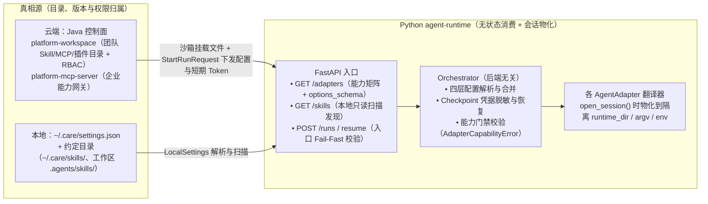
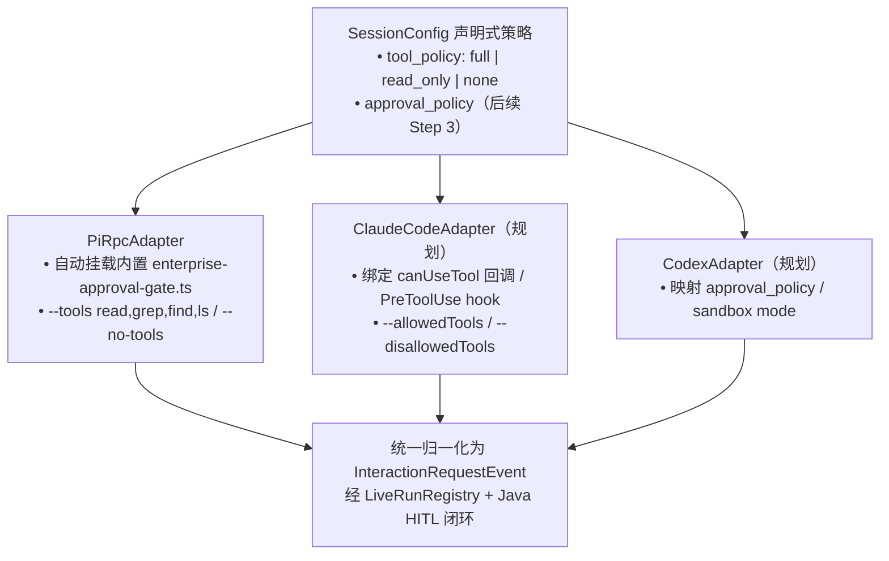

# CARE Agent Runtime 扩展能力设计文档（Skill / MCP / 底座插件）

> **文档状态**：草案（Design Proposal v1.0）  
> **关联文档**：[总体架构设计文档](../architecture.md) · [Agent Runtime 核心设计文档](agent-runtime-design.md) · [配置体系、连续对话与双层中断恢复设计文档](session-and-recovery-design.md)  
> **适用范围**：AI 工程（Python / LangGraph / AgentAdapter）、桌面端（Electron）、后端（Java 控制面 `platform-workspace` / `platform-mcp-server`）

---

## 1. 背景与现状缺口

当前 `services/agent-runtime` 已完成 LangGraph 编排引擎、`PiRpcAdapter`、双层中断恢复与 FastAPI HTTP/SSE 服务化，但在 **Agent 能力扩展（Skill、MCP、底座插件）** 层面尚未对外暴露统一配置接口，也没有对应的发现或注册机制：

| 扩展类型 | 当前代码状态 | 缺口与问题 |
| :--- | :--- | :--- |
| **Skill** | 无任何字段或接口 | `SessionConfig`、`AgentNodeConfig`、`RunOptions`、`LocalSettings`、`StartRunRequest` 均无法指定或发现 Skill。 |
| **MCP** | 无任何字段或接口 | [architecture.md](../architecture.md) 已规划 Java `platform-mcp-server`（Streamable HTTP），但运行时既不能接收 MCP Server 配置，也不能物化给底层 Agent，更无 MCP 密钥脱敏与恢复机制。 |
| **插件 / 扩展** | 仅 `PiRpcConfig.extensions: tuple[Path, ...] = ()` 静态预留 | [transport.py](../../services/agent-runtime/src/agent_runtime/adapters/pi/transport.py) 支持拼装 `--extension`，但 [app.py](../../services/agent-runtime/src/agent_runtime/app.py) 未透出，也无法按工作流/节点/本地配置下发；且不同 Agent 底座（Pi / Claude Code / Codex）的插件机制完全异构。 |
| **注册与发现** | 仅有内部代码级 `AdapterRegistry` / `WorkflowRegistry` | `GET /adapters` 仅返回 `kind` 和 `capabilities`，前端与控制面无法获知底座支持哪些扩展能力及其专属配置结构。 |

此外，当前 `PiRpcTransport` 存在一个**环境隔离不一致的隐患**：[transport.py](../../services/agent-runtime/src/agent_runtime/adapters/pi/transport.py) 仅在传入自定义 `endpoint.base_url` 或 `endpoint.api_key` 时，才将 `PI_CODING_AGENT_DIR` 覆盖为会话级空临时目录 `runtime_dir`（仅写入 `models.json`）。这会导致同一台机器上：
- 使用本机默认模型时，Pi 会静默读取 `~/.pi/agent/mcp.json`、extensions 与 skills；
- 一旦切换到 CARE 的自定义 Profile/Endpoint，`PI_CODING_AGENT_DIR` 指向空临时目录，宿主机 `~/.pi/agent/` 下的 MCP/扩展会**突然全部失效**。

### 设计目标

1. **边界清晰**：严格维持“控制面管注册/存储/权限，Python 运行时做无状态声明式消费与会话物化”的架构铁律，不在 `agent-runtime` 内重复建设重型注册中心数据库。
2. **通用与异构分离**：Skill 与 MCP 抽象为后端无关的标准契约；底座插件按**“平台治理意图”**与**“底座专属配置”**双刀切分，既不伪造脆弱的通用插件 API，也不向 `orchestrator/` 与 `api/` 泄漏任何具体底座实现。
3. **密钥零落盘、零进 Checkpoint**：MCP 认证凭据与现有 `ModelEndpoint.api_key` 共用同一套内存持有、Checkpoint 剥离与 `$ENV_VAR` 子进程注入安全模型。
4. **本地/云端同构与确定性隔离**：修复 `PI_CODING_AGENT_DIR` 行为分裂，确保本地 Sidecar 与云端沙箱对 Skill、MCP、插件的加载范围完全确定、可预测、Fail-Fast。

---

## 2. 总体架构与职责边界

### 2.1 为什么不在 `agent-runtime` 里建持久化注册中心

遵循 [总体架构设计文档](../architecture.md) 的控制面/执行面解耦原则：



| 关注点 | 本地模式（`MODE=local`） | 云端模式（`MODE=cloud`） | `agent-runtime` 职责 |
| :--- | :--- | :--- | :--- |
| **Skill 注册与分发** | `~/.care/skills/` + 工作区 `.agents/skills/` + `~/.care/settings.json` | Java `platform-workspace` 托管版本库，沙箱启动前挂载/同步为本地目录 | 只消费已落盘的 `Path` 列表；本地模式额外提供只读发现扫描供 UI 勾选 |
| **MCP 目录与鉴权** | `~/.care/settings.json` 中的 `mcp_servers` | Java 控制面按用户 RBAC 筛选后，随 `/runs` 请求内存下发（含短期 Token） | 校验结构与能力位，物化为子进程隔离配置（密钥走 env），绝不落盘明文 |
| **底座插件分发** | 本机路径 / 随 Electron 打包内置扩展 | 沙箱镜像内置扩展 + Java 控制面按底座白名单挂载 | 平台内置治理能力由 Adapter 自动挂载；用户专属配置按 `adapter_kind` 校验并透传 |

**核心收益**：系统永远只有一个配置真相源（本地是 `settings.json`，云端是 Java 控制面），彻底避免 Java DB、Python Registry DB、`settings.json`、`~/.pi/agent/` 四份状态互相漂移。

### 2.2 极简设计门禁自检（Minimal Design Gate）

在进入接口细节前，先收口边界以防过度设计：

1. **结构性**：通过统一 `SessionConfig` 契约 + `AgentAdapter.options_model` 解决所有底座的 Skill/MCP/插件注入与 `PI_CODING_AGENT_DIR` 隔离问题，而非为 Pi 零散追加 CLI 透传字段。
2. **调用方负担**：所有新增字段默认空值（不填即沿用既有行为）；不要求调用方为通用场景填写底座专属配置。
3. **系统可推导的不交给调用方**：`options_schema` 由各 Adapter 的 Pydantic 模型自动导出；`PersistedMcpServer.requires_secrets` 由是否存在 `SecretStr` 自动推导；`tool_policy == "none"` 自动关闭 MCP 工具，不新增冗余开关。
4. **克制抽象**：首期不引入 Python MCP Proxy 中间层，直接利用底座原生 MCP 能力；不强造跨底座统一 `Plugin` 模型；不在 `agent-runtime` 引入持久化扩展数据库。
5. **非过拟合**：整套契约同时校验过 Pi、Claude Code、Codex CLI 与未来 ACP 后端，无任何 Pi 私有概念泄漏到 `orchestrator/` 或 `api/`。

---

## 3. 三类扩展的分层模型设计

将“给 Agent 配能力”拆为四类清晰对象，彻底消除概念混杂：

| 类别 | 归属层 | 是否跨底座通用 | 典型示例 | 配置来源 | Checkpoint 持久化 |
| :--- | :--- | :---: | :--- | :--- | :--- |
| **1. Skill** | `SessionConfig` | 是 | 代码评审规范、发布流程 `SKILL.md` | 全局 / 工作流 / 请求 | 仅路径列表（无密钥） |
| **2. MCP Server** | `SessionConfig` | 是 | `platform-mcp-server`、Git/Jira/Sheet MCP | 全局 / 工作流 / 请求 | 剥离密钥的元数据 |
| **3. 平台治理策略** | `SessionConfig` + Adapter 内置 | 是（声明式意图） | 只读限制、`enterprise-approval-gate` 工具审批 | 启动配置 / 节点策略 | 仅策略枚举/配置 |
| **4. 底座专属插件** | `adapter_options`（按 `adapter_kind` 分桶） | 否（强底座绑定） | Pi 自定义 `.ts` extension、Claude `--plugin-dir` | 全局 / 节点 / 请求 | 原样保留非敏感字段（由底座模型声明） |

---

### 3.1 Skill：面向本地路径的开放标准

主流 Coding Agent 底座均兼容 `SKILL.md` 目录规范。为了让 `open_session()` 保持零网络依赖、启动快速且可复现，**Skill 契约在 Runtime 边界只接收已就绪的本地路径**（文件或目录）：

- **数据表达**：`skills: tuple[Path, ...] = ()`（构造期校验非空字符串与规范化，打开会话前 fail-fast 校验路径存在）。
- **与工作区自动发现的关系**：
  - 默认保留工作区级 Skill（例如项目仓库内的 `.agents/skills/`）自动发现，符合开发者预期；
  - 对于强隔离场景（云端只允许企业白名单 Skill，或特定审计节点禁止加载项目内不可信 Skill），由 `discover_default_skills: bool = True` 显式关闭默认发现，仅加载 `skills` 中列出的路径。
- **底座兼容策略**：
  - 支持原生 Skill 参数的底座（如 Pi 的 `--skill`）直接透传；
  - 不支持原生 Skill 参数的底座，由该 Adapter 自行选择“在隔离配置目录软链 `skills/`”或“将 Skill 的 `name + description + SKILL.md 路径` 渐进式索引追加至 `append_system_prompt`”。

---

### 3.2 MCP：标准双传输模型与密钥隔离

MCP Server 配置采用 Pydantic v2 Discriminated Union（`discriminator="transport"`），覆盖本地命令行工具与企业远程网关两类标准传输：

```python
class StdioMcpServer(BaseModel):
    """本地子进程型 MCP Server（仅限受信任的本地/沙箱配置）。"""

    model_config = ConfigDict(frozen=True)

    transport: Literal["stdio"] = "stdio"
    command: str
    args: tuple[str, ...] = ()
    env: dict[str, SecretStr] = Field(default_factory=dict)
    cwd: Path | None = None


class HttpMcpServer(BaseModel):
    """Streamable HTTP 型 MCP Server（对接 CARE platform-mcp-server 与远程企业服务）。"""

    model_config = ConfigDict(frozen=True)

    transport: Literal["http"] = "http"
    url: str  # 校验以 http:// 或 https:// 开头
    headers: dict[str, SecretStr] = Field(default_factory=dict)
    bearer_token: SecretStr | None = None


McpServerConfig = Annotated[
    StdioMcpServer | HttpMcpServer,
    Field(discriminator="transport"),
]
```

#### 密钥安全红线（与 `ModelEndpoint` 保持完全同构）

1. **内存态持有 `SecretStr`**：`StdioMcpServer.env`、`HttpMcpServer.headers` 与 `HttpMcpServer.bearer_token` 均以 `SecretStr` 承载，防止意外被日志、`repr` 或 `RuntimeEvent` 打印泄露。
2. **Checkpoint 结构化剥离**：定义 `PersistedMcpServer`（结构上不包含 `bearer_token`、`headers` 值与 `env` 值，只保留 `transport`、`url`/`command`/`args`/`cwd`、`header_keys`、`env_keys` 与系统推导的 `requires_secrets: bool`）。
3. **断点恢复（`resume`）的凭据补齐**：
   - 同一进程内热恢复：复用 `WorkflowRunner._thread_secrets` 内存缓存；
   - 本地跨进程重启恢复：若 MCP Server 来自 `LocalSettings` 命名配置，按名称从 `~/.care/settings.json` 重新解析；
   - 云端跨容器/冷挂起恢复：若 `requires_secrets=True` 且未在本地配置命中，fail-fast 提示调用方在 `resume` 请求中重新注入最新短期令牌（企业 SSO/OAuth Token 本就不应跨数小时持久化）。
4. **子进程物化不写明文**：写入 `runtime_dir/mcp.json` 时只写环境变量占位符（如 `${CARE_MCP_0_BEARER}` / `bearer_token_env_var`），真实凭据仅注入该子进程的 `env`，会话退出即销毁 `runtime_dir`。

#### 关于“直连底座原生 MCP” vs “Python MCP Proxy”

- **首期优先直连底座原生 MCP**：Pi（原生支持 `mcp.json` + Streamable HTTP + `bearer_token_env_var`）、Claude Code、Codex CLI 均已内置 MCP 客户端。直接物化原生配置可少一层进程转发、保留底座原生的 tool schema 优化（如 Pi 的 `codemode` / `deferred` 暴露模式）。
- **未来演进接缝**：若后续接入不支持 Streamable HTTP / OAuth 的底座，或需要 Python 层对 MCP 工具调用做统一的企业级审计/DLP 拦截，可在不改动 `McpServerConfig` 契约的前提下，于 `adapters/` 旁增加可选的本地 MCP Proxy，将其暴露为标准本地端点喂给底座。

---

### 3.3 Plugin / Extension：双刀切分设计

不同 Agent 底座的插件能力不存在统一运行时模型（Pi 是进程内 TypeScript 钩子，Claude Code 是 plugin directory + shell/HTTP hooks，Codex CLI 主要是 config 与 approval policy）。因此**禁止**抽象通用的 `GenericPlugin` 列表，而是采用**双刀切分**：

#### 第一刀：平台级治理能力 → 提升为后端无关策略，由各 Adapter 内部落地

凡是 CARE 平台自身依赖的核心管控能力（如工具级审批门 `enterprise-approval-gate`、只读工具策略 `tool_policy`、未来的敏感命令拦截策略），都属于**策略契约**而非“某个 TS 文件路径”：



- **强制不可绕过性**：平台级必选扩展（例如企业合规审批门）装配在 `PiRpcConfig`（服务启动层），**始终追加到会话生效列表且不允许单次 API 请求通过 `adapter_options` 关闭**。

#### 第二刀：用户/企业自定义底座插件 → 按 `adapter_kind` 分桶 + Adapter 自声明 Schema

对于真正强绑定底座的自定义插件（例如团队自研的 Pi 扩展脚本、Claude Code 自定义插件目录），明确将其建模为**底座专属选项（Adapter-Scoped Options）**：

1. **每个 Adapter 自行声明强类型选项模型**：
   ```python
   # adapters/pi/options.py（仅 Pi 模块感知，orchestrator/api 绝不 import）
   class PiSessionOptions(BaseModel):
       model_config = ConfigDict(frozen=True, extra="forbid")

       extensions: tuple[Path, ...] = ()
       allow_default_extensions: bool = False
   ```
   ```python
   # adapters/claude/options.py（未来接入 Claude Code 时的示例）
   class ClaudeSessionOptions(BaseModel):
       model_config = ConfigDict(frozen=True, extra="forbid")

       plugin_dirs: tuple[Path, ...] = ()
       setting_sources: tuple[Literal["user", "project", "local"], ...] | None = None
   ```
2. **`AgentAdapter` 协议只暴露一个极薄钩子**：
   ```python
   @runtime_checkable
   class AgentAdapter(Protocol):
       kind: str
       capabilities: AgentCapabilities
       options_model: type[BaseModel] | None  # 无专属选项的底座设为 None

       def open_session(self, config: SessionConfig) -> AbstractAsyncContextManager[AgentSession]: ...
   ```
3. **分桶存放、单桶下发**：
   - 在可混编多底座的层（`LocalSettings`、`StartRunRequest`、`RunOptions`）：按 `adapter_kind` 分桶，类型为 `dict[str, dict[str, Any]]`（例如 `{"pi": {"extensions": [...]}, "claude_code": {"plugin_dirs": [...]}}`）。
   - 在面向单一节点的层（`AgentNodeConfig`、`NodeRuntimeOverride`、`SessionConfig`）：已确定当前节点的 `effective_adapter_kind`，只需持有**该底座对应的单桶字典** `adapter_options: dict[str, Any]`，并在进入 `open_session()` 前通过 `adapter.options_model.model_validate(...)` 完成强类型校验（`extra="forbid"`，拼错字段立刻 Fail-Fast）。
4. **前端/控制面免硬编码**：
   - `GET /adapters` 直接输出 `options_schema = adapter.options_model.model_json_schema() if adapter.options_model else None`，客户端设置页或 Java 控制面可动态校验并渲染各底座插件配置项。

---

## 4. 核心接口与数据结构变更设计

### 4.1 `adapters/base.py` 扩展契约

```python
class AgentCapabilities(BaseModel):
    model_config = ConfigDict(frozen=True)

    streaming: bool = True
    steering: bool = False
    follow_up: bool = False
    abort: bool = False
    session_resume: bool = False
    session_fork: bool = False
    interactions: bool = False
    # 新增扩展能力声明位
    skills: bool = False
    mcp_stdio: bool = False
    mcp_http: bool = False


class SessionConfig(BaseModel):
    model_config = ConfigDict(frozen=True)

    cwd: Path
    endpoint: ModelEndpoint | None = None
    thinking_level: ThinkingLevel | None = None
    system_prompt: str | None = None
    append_system_prompt: str | None = None
    tool_policy: ToolPolicy = "full"
    tools: tuple[str, ...] | None = None
    session_ref: str | None = None
    fork_from_session_ref: str | None = None
    persist_session: bool = False

    # 新增通用扩展与底座专属选项
    skills: tuple[Path, ...] = ()
    discover_default_skills: bool = True
    mcp_servers: dict[str, McpServerConfig] = Field(default_factory=dict)
    adapter_options: dict[str, Any] = Field(default_factory=dict)
```

构造期不变式（Fail-Fast）：
- `tool_policy == "none"` 时，如果同时传入非空 `mcp_servers`，直接抛出 `ValueError`（语义冲突，不静默丢弃 MCP）；
- `mcp_servers` 的 server 名称必须为非空、合法标识符（禁止含空白或破坏底座工具前缀 `mcp__<name>__*` 的字符）；
- `skills` 中每条路径去除首尾空白后不可为空；
- 当 `adapter.capabilities` 声明不支持请求的能力（如传了 `HttpMcpServer` 但 `capabilities.mcp_http == False`，或传了非空 `adapter_options` 但 `adapter.options_model is None`）时，在启动子进程前直接抛 `AdapterCapabilityError`。

---

### 4.2 本地目录与 `~/.care/settings.json` 演进

在现有 `~/.care/` 目录体系（[paths.py](../../services/agent-runtime/src/agent_runtime/paths.py)）下新增一个约定目录：

```text
~/.care/
├── settings.json        # 本地配置唯一真相源（POSIX 0600）
├── skills/              # [新增] 用户全局个人 Skill 目录（每个子目录含 SKILL.md）
├── tmp/                 # 单次子进程瞬态隔离目录（models.json / mcp.json / prompts）
├── sessions/            # 持久化会话历史
└── checkpoints.sqlite   # LangGraph Checkpoint + WAL
```

`~/.care/settings.json` 扩展结构（与现有 `profiles` / `active_profile` 保持同构风格）：

```json
{
  "active_profile": "deepseek",
  "profiles": {
    "deepseek": {
      "model": "deepseek-chat",
      "base_url": "https://api.deepseek.com/v1",
      "api_key": "sk-xxx",
      "api_protocol": "openai-completions"
    }
  },
  "skills": [
    "/Users/alice/.care/skills/code-review"
  ],
  "mcp_servers": {
    "care-workspace": {
      "transport": "http",
      "url": "https://care.internal/mcp",
      "bearer_token": "tok-xxx"
    },
    "filesystem-docs": {
      "transport": "stdio",
      "command": "npx",
      "args": ["-y", "@modelcontextprotocol/server-filesystem", "/Users/alice/docs"]
    }
  },
  "adapters": {
    "pi": {
      "bin": "/opt/homebrew/bin/pi",
      "options": {
        "extensions": [
          "/Users/alice/.care/extensions/pi/custom-lint.ts"
        ],
        "allow_default_extensions": false
      }
    }
  }
}
```

> **关于现有 `adapter_bins` 的演进原则**：当前项目仍处于 `v0.0.1` 早期，若将 `adapter_bins: dict[str, str]` 升级为按底座聚合的 `adapters: dict[str, AdapterLocalConfig]`（含 `bin` 与 `options`），应在同一提交中同步更新全部调用方、测试与文档，**不保留双格式兼容垫片**（如若阶段一暂不想改动现有本地 `settings.json` 的 `adapter_bins`，则可先新增 `adapter_options: dict[str, dict[str, Any]]`，二者选一并保持唯一真相）。推荐直接收敛到 `adapters.<kind>.{bin, options}`，长期结构最干净。

---

### 4.3 编排层分层解析、合并规则与 `inherit_session_from`

#### 四层配置优先级与合并语义

沿用 [node.py](../../services/agent-runtime/src/agent_runtime/orchestrator/node.py) 的解析链，明确区分**强制追加**、**叠加合并**与**覆盖**：

| 配置项 | 层级顺序（高 → 低） | 合并规则 |
| :--- | :--- | :--- |
| **平台内置治理扩展** | `ServerConfig` / `Adapter` 启动配置 | **始终生效**，不可被节点或 API 请求移除 |
| **`skills`** | `NodeRuntimeOverride` > `AgentNodeConfig` > `RunOptions`（含本地默认） | 节点/覆盖层为 `None` 时继承上层；显式传入时按路径去重合并（传 `()` 可显式清空该节点的附加 Skills） |
| **`discover_default_skills`** | `NodeRuntimeOverride` > `AgentNodeConfig` > `RunOptions` | 标量覆盖（`None` 表示继承） |
| **`mcp_servers`** | `NodeRuntimeOverride` > `AgentNodeConfig` > `RunOptions`（含本地默认） | 按 `server_name` 浅合并（高优先级同名覆盖低优先级）；节点显式设 `mcp_servers={}` 或 `tool_policy="none"` 时清空 |
| **`adapter_options`** | 仅取 `effective_adapter_kind` 对应桶：`NodeRuntimeOverride` > `AgentNodeConfig` > `RunOptions`（含本地默认） | 浅合并后交由 `adapter.options_model.model_validate()` 校验（列表型字段如 `extensions` 在同底座内去重合并，避免覆盖丢失） |

> **极简约束**：如果 `NodeRuntimeOverride` / `AgentNodeConfig` 设 `tool_policy="none"`，运行时自动将 `effective_mcp_servers` 置空（除非同时显式传入非空 `mcp_servers` 触发校验报错），避免再额外引入 `enable_mcp` 布尔开关。

#### 与 `inherit_session_from` 的协同

现有 [node.py](../../services/agent-runtime/src/agent_runtime/orchestrator/node.py) 通过 `NodeOutput.session_settings` 在 fork 会话时自动继承源节点的提示词与工具集，并在节点显式覆写时发出 Prompt Cache 失效告警。扩展后同步将以下**非敏感摘要**纳入 `session_settings`：
- `skills`: 生效路径字符串列表
- `discover_default_skills`: 布尔值
- `mcp_server_names`: 排序后的 MCP server 名称列表（**不含密钥**）
- `adapter_options`: 校验后的非敏感序列化字典

下游 `inherit_session_from` 节点未显式覆写上述字段时自动沿用源节点配置，保证 `plan_and_execute` 等工作流跨节点 fork 后上下文与工具定义稳定。

#### Checkpoint 脱敏与 `resume` 恢复

在 [state.py](../../services/agent-runtime/src/agent_runtime/orchestrator/state.py) 与 [runner.py](../../services/agent-runtime/src/agent_runtime/orchestrator/runner.py) 中复用现有模式：
- `PersistedRunOptions` / `PersistedNodeOverride` 新增：
  - `skills: tuple[str, ...]`
  - `discover_default_skills: bool`
  - `mcp_servers: dict[str, PersistedMcpServer]`（零密钥，含自动推导的 `requires_secrets: bool`）
  - `adapter_options: dict[str, dict[str, Any]]`
- `WorkflowRunner._thread_secrets` 扩展为同时缓存当前进程生命周期内的 `mcp_secrets`；
- 本地模式支持将 `mcp_servers` 标记为来自 `LocalSettings`（通过 `mcp_server_names` 引用），跨重启 `resume` 时自动从 `~/.care/settings.json` 重新加载最新凭据；
- 云端模式或内联传密钥的 MCP Server，跨重启 `resume` 时若内存无缓存且调用方未重新传入 `mcp_servers`，直接抛 `InvalidInputError`（与现有内联 `ModelEndpoint` 行为完全一致）。

---

### 4.4 HTTP API 契约扩展（`api/routes.py` & `api/schemas.py`）

1. **增强 `GET /adapters`**：
   ```python
   class AdapterInfo(BaseModel):
       model_config = ConfigDict(frozen=True)

       kind: str
       capabilities: AgentCapabilities
       options_schema: dict[str, Any] | None = None
   ```
2. **扩展 `POST /runs` 与 `POST /workflows/{workflow_id}/threads/{thread_id}/resume`**：
   - `StartRunRequest` / `ResumeThreadRequest` 新增可选字段：
     - `skills: tuple[str, ...] | None = None`
     - `discover_default_skills: bool | None = None`
     - `mcp_servers: dict[str, McpServerConfig] | None = None`
     - `adapter_options: dict[str, dict[str, Any]] | None = None`
   - `NodeRuntimeOverride` 同步新增节点级可选字段（`skills`、`discover_default_skills`、`mcp_servers`、`adapter_options: dict[str, Any] | None`）。
   - **入口预校验**：路由层在启动后台任务前，即可根据 `adapter_registry` 对主底座与 `node_overrides` 中各目标底座的 `adapter_options` 和 `mcp_servers` 能力位做 Fail-Fast 校验，非法配置同步返回 `422` / `400`，不会延迟到后台任务异步炸掉。
3. **新增只读发现接口 `GET /skills`（可选，Step C）**：
   - 查询参数：`workspace_dir: str | None = None`；
   - 仅扫描 `~/.care/skills/`、本地配置 `settings.json` 及可选工作区 `.agents/skills/` 中包含 `SKILL.md` 的目录，解析 frontmatter 中的 `name` 与 `description` 返回只读列表，供桌面端 UI 展示和勾选；
   - **定位明确**：只是只读文件系统扫描视图，不写入数据库、不承担注册中心状态。

---

## 5. 多 Agent 底座适配矩阵与 `PiRpcAdapter` 落地细节

### 5.1 跨底座物化对照表

| 能力 | `PiRpcAdapter`（首期） | `ClaudeCodeAdapter`（规划） | `CodexAdapter`（规划） |
| :--- | :--- | :--- | :--- |
| **隔离目录** | `PI_CODING_AGENT_DIR=<runtime_dir>` | 临时配置目录 + `--strict-mcp-config` | `CODEX_HOME=<runtime_dir>` |
| **Skill 注入** | `--skill <path>`（禁用默认发现时按实测加 `--no-skills`） | 软链到隔离目录 `skills/` 或 `append_system_prompt` 索引 | 软链到 `$CODEX_HOME/skills/` 或 `append_system_prompt` 索引 |
| **MCP 注入** | 写 `runtime_dir/mcp.json`（密钥走 env var）；无 MCP 且禁用时传 `--no-mcp` | 写 `runtime_dir/mcp.json` + `--mcp-config <path>` | 写 `$CODEX_HOME/config.toml` 的 `[mcp_servers.*]` |
| **平台审批门** | 内置 `enterprise-approval-gate.ts` 经 `--extension` 加载，走 `extension_ui_request` | SDK `canUseTool` 或 `PreToolUse` hook 桥接 | 原生 approval policy / exec approval 事件 |
| **用户专属插件** | `PiSessionOptions.extensions` → `--extension <path>`（默认加 `--no-extensions` 防宿主机污染） | `ClaudeSessionOptions.plugin_dirs` → `--plugin-dir <path>` | `CodexSessionOptions`（按需暴露 sandbox/config 项） |

### 5.2 `PiRpcAdapter` 具体落地方案

#### 1. 统一 `PI_CODING_AGENT_DIR` 隔离策略（修复现有缺陷）

调整 `build_pi_argv()`（[transport.py](../../services/agent-runtime/src/agent_runtime/adapters/pi/transport.py)）：
- **始终创建并注入隔离 `PI_CODING_AGENT_DIR = str(runtime_dir)`**（除非显式需要沿用宿主机登录态，且即便沿用认证也只以受控方式处理——本地默认模型如需读取 `~/.pi/agent/auth.json`，可明确文档化规则：仅在 `endpoint is None` 时不覆盖 `PI_CODING_AGENT_DIR`，或在 `runtime_dir` 仅按需承接 `models.json` 与 `mcp.json`；**最确定性的方案**是当 CARE 接管 `endpoint` 或 `mcp_servers` 时均写入 `runtime_dir` 并设 `PI_CODING_AGENT_DIR=runtime_dir`，且在仅设 `mcp_servers` 未设 `endpoint` 时，若宿主机 `~/.pi/agent/auth.json` 存在则只读软链该文件，确保 OAuth 登录态与 CARE 注入的 MCP 能同时工作！）。
- **扩展隔离**：默认传 `--no-extensions` 屏蔽宿主机 `~/.pi/agent/extensions` 自动发现（显式 `--extension <path>` 依然生效，符合 Pi CLI 文档语义），除非 `PiSessionOptions.allow_default_extensions=True`。
- **MCP 隔离**：
  - `session_config.mcp_servers` 非空时，生成 `runtime_dir/mcp.json`：
    - `HttpMcpServer` 写入 `url`、`headers`（值替换为 `${CARE_MCP_<idx>_HDR_<k>}`）及 `bearer_token_env_var = "CARE_MCP_<idx>_BEARER"`；
    - `StdioMcpServer` 写入 `command`、`args`、`cwd`、`env`（值替换为 `${CARE_MCP_<idx>_ENV_<k>}`）；
    - 所有真实凭据仅注入该子进程的 `env`，不写入磁盘文件。
  - `session_config.mcp_servers` 为空且 `tool_policy == "none"` 时传 `--no-mcp`。
- **平台扩展与用户扩展叠加顺序**：
  - 先加载 `PiRpcConfig.extensions`（服务装配层内置/强制治理扩展），再加载 `PiSessionOptions.extensions`（用户/节点专属扩展），按规范化路径去重。
- **Skill 映射与待实测点**：
  - 对 `session_config.skills` 每条路径追加 `["--skill", str(path)]`；
  - **实现前必测**：确认当前安装版本 `pi` 中 `--no-skills` 与显式 `--skill <path>` 同时传入时，是否像 `--no-extensions` + `--extension` 一样保留显式 `--skill`；若 `--no-skills` 会一并屏蔽显式 `--skill`，则仅在 `discover_default_skills=False and not skills` 时传 `--no-skills`。

---

## 6. 安全边界与 Fail-Fast 清单

### 6.1 安全红线

1. **云端模式防越权执行（关键）**：
   - 在 `MODE=cloud` 下，若外部请求直接传入任意 `StdioMcpServer.command` 或任意宿主机路径的 `PiSessionOptions.extensions`，等价于远程代码执行（RCE）。
   - 因此云端模式增加明确安全约束：
     - `ServerConfig` 提供 `allow_stdio_mcp: bool`（本地默认 `True`，云端默认 `False`）与 `allowed_extension_roots: tuple[Path, ...]`（云端限制只能引用沙箱预置只读目录内的扩展文件，校验 `resolve().is_relative_to(root)`）。
2. **凭据脱敏覆盖全链路**：
   - `McpServerConfig` 中所有凭据用 `SecretStr`；
   - `redact_sensitive_text()` 继续兜底截断和遮蔽所有错误消息与子进程 `stderr`；
   - Checkpoint 序列化与 `RuntimeEvent` 契约测试必须断言零密钥泄漏。

### 6.2 失败模式矩阵

| 场景 | 检测时机 | 预期行为（Fail-Fast） |
| :--- | :--- | :--- |
| 传入未知底座选项字段（如 `adapter_options={"pi": {"foo": 1}}`） | API 入口 / `run_turn` 启动前 | `InvalidInputError`（HTTP 422） |
| 某底座不支持 `mcp_http` / `mcp_stdio` / `skills` 但请求传入了对应配置 | API 入口 / `run_turn` 启动前 | `AdapterCapabilityError`（HTTP 400） |
| `tool_policy="none"` 同时传入非空 `mcp_servers` | `SessionConfig` 构造期 | `ValueError` / `InvalidInputError` |
| `skills` 或 `PiSessionOptions.extensions` 路径不存在 | `open_session` 启动前 | `AdapterStartupError` |
| 云端模式下请求传入 `StdioMcpServer` 或越界 `extension` 路径 | API 入口 / 策略校验层 | `InvalidInputError`（HTTP 400） |
| 跨进程 `resume` 时存在 `requires_secrets=True` 的内联 MCP 且未重新提供凭据 | `WorkflowRunner._resolve_resume_options` | `InvalidInputError`（明确提示缺少哪些 server 的凭据） |

---

## 7. 分期实施路线与验证策略

### 分期计划

| 阶段 | 交付内容 | 涉及主要文件 |
| :--- | :--- | :--- |
| **Phase A：契约与 Pi 物化闭环** | 新增 `McpServerConfig`、`AgentCapabilities` 扩展位、`SessionConfig` 字段与 `AgentAdapter.options_model`；实现 `PiSessionOptions`、`runtime_dir/mcp.json`（环境变量凭据注入）、`--skill` / `--extension` 与 `PI_CODING_AGENT_DIR` 隔离统一。 | `adapters/base.py`, `adapters/pi/{options,transport,adapter}.py` |
| **Phase B：编排层、脱敏与 HTTP/本地配置** | 打通 `AgentNodeConfig`、`RunOptions`、`NodeRuntimeOverride`、`PersistedMcpServer`、`WorkflowRunner` 凭据恢复、`LocalSettings` 与 `api/{routes,schemas}.py`（含 `GET /adapters` 输出 `options_schema` 与云端安全开关）。 | `orchestrator/{live_runs,node,state,runner}.py`, `settings.py`, `config.py`, `api/{routes,schemas}.py` |
| **Phase C：发现接口、多底座与云端联动** | 新增本地只读 `GET /skills` 扫描；接入第二个底座（Claude Code / Codex）验证契约通用性；对接 Java `platform-workspace` 与 `platform-mcp-server` 完成云端下发闭环。 | `api/routes.py`, `adapters/<next>/`, `platform-java` |

### 测试验证策略（端到端优先）

遵循仓库 `e2e-first-testing` 规范，替身止于外部子进程边界：
1. **扩展 `tests/fakes/fake_pi_rpc.py`**：在协议替身启动时把接收到的 `argv`、`PI_CODING_AGENT_DIR/mcp.json` 内容与安全脱敏后的环境键名回显至测试断言，端到端验证：
   - `skills`、`mcp_servers`（stdio + http）、`PiSessionOptions.extensions` 正确物化到子进程；
   - `runtime_dir/mcp.json`、命令行 `argv`、SQLite Checkpoint、`RuntimeEvent` 流中**均零明文密钥**；
   - 节点级覆写、跨节点 `inherit_session_from` 继承与跨重启 `resume` 凭据恢复/报错路径；
   - `GET /adapters` 返回有效 JSON Schema，非法 `adapter_options` 与云端越权配置在 `/runs` 入口同步 Fail-Fast。
2. **纯模型/配置单元测试**：补充 `McpServerConfig`、`PersistedMcpServer`、`LocalSettings` 与四层合并函数的失败模式测试。

---

## 8. 编码前待确认事项（Open Questions）

1. **`settings.json` 中 `adapter_bins` 的处理方式**：是否直接重构为按底座分桶的 `adapters.<kind>.{bin, options}`（一次性迁移现有调用与测试，不留兼容垫片），还是先保留 `adapter_bins` 并新增并列的 `adapter_options`？
2. **Pi 版本实测确认**：落地 Phase A 前需实测本机 `pi` 版本中：
   - `mcp.json` 的确切 JSON Schema（`bearer_token_env_var`、headers 环境变量插值语法）；
   - `--no-skills` 与显式 `--skill <path>` 同时使用时的实际优先级行为。
3. **云端模式默认策略**：云端沙箱内是否完全禁止 `StdioMcpServer`（只开放 Streamable HTTP MCP 对接 `platform-mcp-server`），还是允许通过白名单镜像内置工具运行特定 `stdio` MCP？
4. **平台内置审批门时机**：是否把 Step 3 的 `approval_policy` 声明位一并预留进 Phase A，还是等 `packages/pi-extensions/enterprise-approval-gate` 实际动工时再加（遵循极简门禁建议：**等实际有读取方时再加字段**）。
