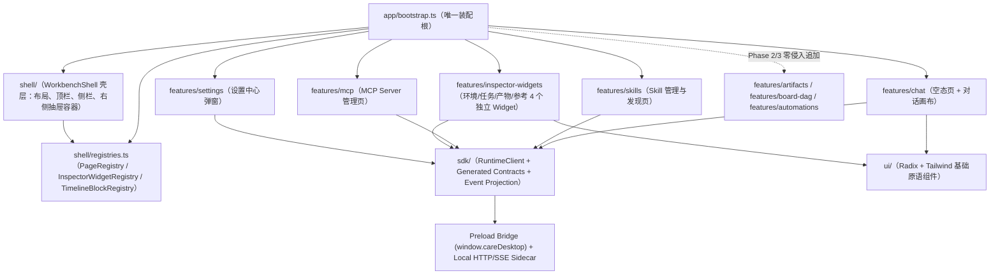
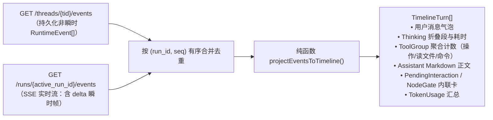

# CARE 桌面端（Electron）前端架构与界面设计文档

> **文档状态**：已确认（Architecture & UI Design v1.1，准备进入 Phase 1A 编码）  
> **关联文档**：[总体架构设计文档](../architecture.md) · [Agent Runtime 核心设计文档](../agent-runtime/agent-runtime-design.md) · [配置体系、连续对话与双层中断恢复设计文档](../agent-runtime/session-and-recovery-design.md) · [Skill / MCP / 底座插件设计文档](../agent-runtime/skills-mcp-plugins-design.md)  
> **适用范围**：前端（Electron / React / TypeScript）、AI 工程（Python `agent-runtime` 协议联调）、后端（Java 控制面演进衔接）

---

## 1. 设计目标与视觉定调

`apps/desktop` 是 CARE 双模 AI Agent 协同工作台的桌面客户端，基于仓库已初始化的 **`pnpm + Electron 44 + electron-vite 5 + React 19 + TypeScript 5.9`** 构建。

### 1.1 视觉与信息架构定调（对齐设计稿）

桌面端追求**克制、温暖、低噪音的 macOS 原生级工作台体验**（拒绝重型 IDE 堆砌与传统后台管理风），融合以下两套参考形态：

| 区域 | 对齐规范 | 核心交互特征 |
| :--- | :--- | :--- |
| **整体美学与配色** | 暖白极简桌面风（图 1 / 图 2） | 柔和暖灰侧栏（`#F7F7F5`）+ 纯白主画布（`#FFFFFF`）+ 细边框圆角浮层卡片（`#EAEAE6`），高对比度深炭正文，大面积呼吸感留白。 |
| **左侧边栏 & 空态欢迎页** | 统一单侧栏 + 居中任务发起（图 3） | **不设独立最左极窄 Icon 窄轨**；左侧统一为可折叠单侧栏，顶部含工具行 + **3 个核心一级功能入口按钮**（**新建任务 / Skill / MCP**），下方依次为 `项目` 分组树与 `最近` 会话，左下角为空间与设置入口；空态页为居中品牌标识 + 悬浮输入框 + 下挂项目目录胶囊。 |
| **会话主画布（运行态 / 完成态）** | 流式聚合执行 + 双模热干预（图 1 / 图 2） | 右对齐暖灰用户气泡；运行态展示折叠 `已思考 Xs` 与聚合工具摘要行（如 `已执行 1 个操作 · 已读取 5 个文件 · 已运行 3 条命令 >`）；完成态折叠为 `已完成 Xm Ys >` + 完整 Markdown 与代码块；运行中底部输入框无缝切换为 **`Enter 排队（follow-up），⌘/Ctrl+Enter 插话（steer）`** + 黑色停止按钮（`abort`）。 |
| **右侧可折叠上下文抽屉** | 悬浮卡片式多 Widget 堆叠 + 原地拉宽详情态（图 1 / 图 2） | 默认为右侧悬浮白卡（~280px），按模块化 Widget 垂直堆叠可折叠区块（`环境信息` / `任务清单` / `产物` / `参考`）；点击 `变更 +3 -1`、项目文件或产物时，**右侧抽屉原地拉宽（~560–720px）展开详情视图**（如 Unified Diff / 只读代码预览），顶部提供 `← 返回概览` 一键收回到紧凑卡片态，始终不遮挡左侧对话流。 |

### 1.2 核心架构原则（以工程视角对齐后端）

为让后端背景的开发者也能一眼看懂并高效维护前端代码，前端采用与 `services/agent-runtime` 完全同构的分层与扩展思想：

| 后端架构概念 | 本前端对应机制 | 解决的核心问题 |
| :--- | :--- | :--- |
| **Spring Boot 启动装配根 / `app.py`** | `app/` + `shell/`（工作台壳层） | 只负责布局骨架、主题、插槽渲染与依赖装配，**零具体业务代码**。 |
| **Java SPI / `WorkflowRegistry` / `AdapterRegistry`** | **声明式贡献注册表**（`PageRegistry`、`InspectorWidgetRegistry`、`TimelineBlockRegistry`） | 左侧每一个功能页、右侧每一个抽屉卡片、对话中每一类特殊工具卡片都可独立解耦开发、按声明注册，**新增页面或右侧小卡片无需改动 Shell 代码**。 |
| **CQRS / Event Sourcing 投影** | `projectEventsToTimeline(events)` 纯函数 | 历史回放（`GET /threads/{id}/events`）与实时 SSE（`GET /runs/{id}/events`）走**同一套确定性状态归约**，彻底消除“实时流显示一套、重启后历史显示另一套”的分裂。 |
| **Control Plane / Execution Plane 隔离** | `Main`（系统/Sidecar） ↔ `Preload`（白名单 IPC） ↔ `Renderer`（沙箱 UI） | Renderer 严禁直接触碰 Node/FS/子进程；所有本地 AI 调用走统一 `RuntimeClient`，未来平滑切换至云端 Java 控制面。 |

### 1.3 极简设计门禁自检（Minimal Design Gate）

1. **结构性**：通过三大轻量注册表 + 统一 `RuntimeClient` + 纯函数事件投影，一次性解决“多页面扩展、右侧面板插件化、本地/云端双模切换、历史与实时流一致”四类结构性问题。
2. **克制抽象**：插件化采用**编译期静态模块化注册（In-Process Contribution Registry）**，**绝不引入**微前端（qiankun / Module Federation）、动态远程 JS 加载或重型事件总线；业务模块之间**严禁相互 import**。
3. **不提前拆分多包**：当前只有 `apps/desktop` 一个消费端，Phase 1 在 `apps/desktop/src/renderer/src/` 内用清晰的 `sdk/` 与 `ui/` 目录保持零耦合边界，待 Phase 2 启动 `apps/mobile-web` 时再零成本平移提升为根目录 `packages/sdk-client` 与 `packages/ui-core`，避免单消费者过早承受跨包构建负担。
4. **系统可推导的不手写维护**：会话运行状态、思考时长、工具聚合计数、上下文用量环形图、多节点工作流进度均由 `RuntimeEvent` 与 `ThreadState` 推导生成，不引入易漂移的冗余布尔标志。

---

## 2. 技术栈与 UI 选型

基于 `apps/desktop/package.json` 现有环境（Electron 44 + React 19 + Vite 8 + TypeScript 5.9 + pnpm），推荐最小、高质量、无视觉包袱的依赖组合：

| 能力域 | 推荐选型 | 选型理由与取舍说明 |
| :--- | :--- | :--- |
| **样式引擎** | **Tailwind CSS v4**（`@tailwindcss/vite`） | 与 Vite 8 原生集成、零运行时开销，配合 CSS Custom Properties 精准实现暖白极简设计稿与未来暗色主题。 |
| **基础交互组件库** | **Radix UI Primitives**（按需引入 Dialog / Popover / DropdownMenu / Tooltip / Collapsible / ScrollArea / Tabs）+ `class-variance-authority` + `tailwind-merge` | **为何不选 Ant Design / MUI**：重型组件库自带强烈的设计语言，改成图 1–3 的暖白原生质感反而要大量覆写 CSS；Radix 提供无头（Headless）无障碍键盘交互、焦点管理与弹窗定位，外观 100% 由自家 Design Tokens 掌控（即 shadcn/ui 理念）。 |
| **图标库** | **Lucide React** | 线条纤细统一（`strokeWidth={1.6}`），与图 1–3 极简风格完全契合，支持按需 Tree-shaking。 |
| **状态管理** | **Zustand** | 极简轻量、原生支持细粒度 selector 订阅，适合隔离高频流式增量更新；写法类似后端按领域划分的 Service Store，远比 Redux 简洁。 |
| **Markdown 与代码高亮** | `react-markdown` + `remark-gfm` + `shiki` | GFM 表格/任务列表 + Shiki（VS Code 同款 TextMate 语法引擎，按需异步加载语言包，外观与性能俱佳）。 |
| **Diff 预览** | `diff`（轻量文本 Diff 计算）+ 自定义 Unified/Split Diff 渲染组件 | **不引入 Monaco Editor**：桌面端定位是协同审阅而非重造 VS Code，避免数十 MB 打包体积与启动延迟，并提供“在 VS Code / Cursor / IntelliJ / 终端打开”。 |
| **契约类型生成** | `json-schema-to-typescript` + `openapi-typescript` | 单向消费 [canonical-event.schema.json](file:///Users/atri/DevLab/Agents/CARE/contracts/canonical-event.schema.json) 与 FastAPI OpenAPI，保障前后端协议零漂移。 |
| **测试框架** | **Vitest**（纯逻辑/投影/SSE 解析失败模式测试）+ **Playwright**（Electron E2E） | 遵循仓库 `e2e-first-testing` 规范。 |

---

## 3. 整体界面布局与交互蓝图

### 3.1 两大核心画面结构

#### A. 空态欢迎页（对标图 3，新建任务默认视图）

```text
┌───────────────────────────┬───────────────────────────────────────────────────────────────┐
│ ○ ○ ○  [◧] [←]    [Q] [🔔]│                                                        [◫] [◨]│
├───────────────────────────┤                                                               │
│  ⊕  新建任务               │                                                               │
│  ⚡ Skill                  │                           [ CARE ]                            │
│  🔌 MCP                    │                                                               │
│                           │                     和 CARE 一起开始新任务                      │
│  项目 ▾                   │                                                               │
│   ▸ 📁 CARE               │        ┌─────────────────────────────────────────────┐        │
│   ▸ 📁 DataAgent-Next     │        │ 描述任务，输入 / 调用技能...                  │        │
│   + 添加项目目录           │        │                                             │        │
│                           │        │ [+] [工作流/审批 ▾]       [Profile ▾]  ( ↑ ) │        │
│  最近 ▾                   │        └─────────────────────────────────────────────┘        │
│   • 梳理后端权限架构        │         └─ 📁 CARE (main) ▾   [本地模式 ▾] ────────┘         │
│   • 修复 SSE 断连重放      │                                                               │
│                           │            梳理当前仓库架构      规划并实现新模块                │
│                           │                                                               │
├───────────────────────────┤                                                               │
│ [头像] 个人空间       [⚙] │                                                               │
└───────────────────────────┴───────────────────────────────────────────────────────────────┘
```

#### B. 会话开发页（对标图 1 / 图 2，含右侧可折叠悬浮抽屉）

```text
┌───────────────────────────┬─────────────────────────────────────────┬─────────────────────┐
│ ○ ○ ○  [◧] [←]    [Q] [🔔]│  📁 介绍一下当前这个项目  [本地] ···     │ [打开位置 ▾] [◫] [◨]│
├───────────────────────────┤─────────────────────────────────────────┼─────────────────────┤
│  ⊕  新建任务               │ [多节点时显示] ● Planner (打磨中) ──▶ ○ Executor             │
│  ⚡ Skill                  │                                         │ ┌─────────────────┐ │
│  🔌 MCP                    │                     ┌─────────────────┐ │ │ 环境信息 ▾      │ │
│                           │                     │ 介绍一下当前项目 │ │ │ 变更     +3 -1  │ │
│  项目 ▾                   │                     └─────────────────┘ │ │ 本地 / 云端     │ │
│   ▾ 📁 CARE               │                                         │ │ ⎇ main       ▾  │ │
│     ● 介绍一下当前项目 [↻] │  ⚙ 已思考 1s                            │ │ ⇪ 提交或推送    │ │
│     · 重构路由依赖         │  我先加载项目解读技能，再梳理这个仓库。    │ ├─────────────────┤ │
│   ▸ 📁 DataAgent-Next     │  ▸ 已执行 1 个操作 · 已读取 5 个文件 ·    │ │ 任务清单 ▾      │ │
│                           │    已运行 3 条命令 >                     │ │ 暂无任务 / 节点 │ │
│  最近 ▾                   │  ─────────────────────────────────────  │ ├─────────────────┤ │
│   · ...                   │  ■■■ CARE 正在执行  29s                  │ │ 产物 ▾          │ │
│                           │                                         │ │ 暂无产物 / 列表 │ │
│                           │  (若触发审批/awaiting_input，内联浮现)   │ ├─────────────────┤ │
│                           │  ┌─ 交互 / 放行卡片 ──────────────────┐  │ │ 参考 ▾       8  │ │
│                           │  │ Planner 规划完成，是否进入执行？    │  │ │ ▸ 项目文件   8  │ │
│                           │  │ [继续打磨]  [确认并执行]  [放弃]   │  │ └─────────────────┘ │
│                           │  └───────────────────────────────────┘  │                     │
│                           │                                         │  (右侧悬浮白卡，     │
│                           │  ┌───────────────────────────────────┐  │   内部由 Inspector  │
│                           │  │ 执行中：Enter 排队，⌘/Ctrl+Enter 插话│  │   WidgetRegistry    │
│                           │  │ [+] [帮我审批 ▾]    ◔ [Profile ▾] ■ │  │   动态装配)         │
│                           │  └───────────────────────────────────┘  │                     │
├───────────────────────────┤             内容由 AI 生成，请注意核实    │                     │
│ [头像] 个人空间       [⚙] │                                         │                     │
└───────────────────────────┴─────────────────────────────────────────┴─────────────────────┘
```

### 3.2 界面交互与 `agent-runtime` 协议的精准映射

| UI 元素 / 用户动作 | 底层接口 / 事件映射 | 说明 |
| :--- | :--- | :--- |
| 左侧栏加载项目与会话树 | `GET /threads` | 按 `workspace_dir` 聚合为 `项目` 分组树，同时按 `updated_at` 渲染 `最近`；在线线程自动显示图 2 的旋转进度环（`status === 'running'`），异常中断显示恢复标识（`status === 'crashed'`）。 |
| 点开任意历史会话 | `GET /workflows/{wf}/threads/{tid}` + `GET /threads/{tid}/events`（若有 `active_run_id` 则续接 `GET /runs/{active_run_id}/events`） | 历史回放与实时 SSE 走同一套 `projectEventsToTimeline()` 渲染，按 `(run_id, seq)` 去重。 |
| 空态页 / 空闲态发送任务 | `POST /runs`（新线程或已完结线程续聊） | 携带 `workflow_id`、`prompt`、`workspace_dir`、`profile`、`thinking_level`、`interaction_mode: "wait"`；返回 `RunSnapshot` 后立即挂载 SSE 流。 |
| 运行中按 `Enter` | `POST /runs/{run_id}/follow-up` | 队列追加指令（图 2：`Enter 排队`）。 |
| 运行中按 `⌘/Ctrl+Enter` | `POST /runs/{run_id}/steer` | 实时插话纠偏（图 2：`⌘/Ctrl+Enter 插话`）。 |
| 运行中点黑色方块按钮 `■` | `POST /runs/{run_id}/abort`（二级菜单提供 `POST /runs/{run_id}/suspend`） | 立即中止当前 Turn，或选择挂起保留现场。 |
| `plan_and_execute` 的 `planner` 停在 `awaiting_input` | `POST /workflows/{wf}/threads/{tid}/resume`（继续打磨传 `{prompt}`；确认执行传 `{complete: true}`） | 在对话底部内联展示阶段放行条；放弃则调用 `POST /workflows/{wf}/threads/{tid}/discard`。 |
| 阻塞型审批/提问卡（`interaction.request`） | 热交互调 `POST /runs/{run_id}/interactions`；冷挂起恢复调 `POST /workflows/{wf}/threads/{tid}/resume`（带 `interaction_response`） | 卡片渲染完全由 `InteractionRequestEvent` 驱动，热/冷态由 `ThreadState.active_run_id` 自动分流。 |
| 输入框模型选择器 & 设置弹窗 | `GET /settings`、`PUT /settings`、`GET /workflows`、`GET /adapters` | 设置页修改模型 Profile 时遵循 `api_key` 三态协议（未改动省略保留、输入新值轮换、点清除传 `null`），前端永远不接触明文已存密钥。 |

### 3.3 视觉 Design Tokens（CSS Variables 规范）

所有样式严格基于语义化 CSS 变量，禁止在业务组件中写死色值，便于后续一键扩展暗色模式：

```css
:root {
  /* 背景层级（对标图 1-3 的暖白桌面质感） */
  --bg-sidebar: #f7f7f5;          /* 左侧导航栏暖灰底 */
  --bg-canvas: #ffffff;           /* 中央主画布纯白底 */
  --bg-surface: #ffffff;          /* 输入框与右侧悬浮白卡 */
  --bg-subtle: #f3f3f0;           /* 用户气泡、代码头、次级按钮 */
  --bg-hover: #efefec;            /* 列表项悬停 */
  --bg-active: #e9e9e5;           /* 列表项选中（如图 1/2 选中态） */

  /* 边框与阴影 */
  --border-hairline: #e8e8e4;     /* 1px 极细分割线 */
  --border-card: #e5e5e0;         /* 悬浮卡片描边 */
  --shadow-floating: 0 4px 20px rgba(0, 0, 0, 0.05), 0 1px 3px rgba(0, 0, 0, 0.04);

  /* 文本与强调色 */
  --text-primary: #1c1c1a;
  --text-secondary: #6b6b66;
  --text-muted: #9b9b95;
  --accent-primary: #1f1f1d;      /* 发送/停止按钮深炭黑，保持极简高级感 */
  --status-success: #2f855a;      /* Git +3 / 已完成 */
  --status-danger: #c53030;       /* Git -1 / 错误 / 高危审批 */
  --status-warning: #b7791f;      /* 挂起 / Stale Dependency */
}
```

---

## 4. 模块化与插件化扩展架构（核心设计）

回应“左侧功能页、右侧抽屉内容能否像后端插件/模板一样解耦”的诉求：我们在前端工作台壳层（`shell/`）与具体业务功能（`features/`）之间建立 **三套极薄的声明式注册表（Contribution Registries）**。

> **设计铁律（与 `agent-runtime/workflows/` 保持一致）**：
> 1. `shell/` 只依赖注册表契约（`shell/contracts.ts`），**绝不 import 任何 `features/*`**；
> 2. `features/*` 之间**严禁互相 import**，跨模块共享状态只通过 `stores/` 或 `shell` 提供的导航上下文交互；
> 3. 唯一的装配点是 `app/bootstrap.ts`，集中把各 Feature 的描述符注册进对应 Registry——等同于后端的组装根。



### 4.1 扩展点一：左侧功能页插件化（`PageRegistry`）

左侧边栏顶部按钮（首期固定为 **`新建任务` / `Skill` / `MCP`**）及未来新增的企业页面（`产物中心`、`团队看板`、`自动化触发器`），全部抽象为统一的 `PageContribution`：

```ts
// src/renderer/src/shell/contracts.ts
import type { ComponentType } from 'react'
import type { LucideIcon } from 'lucide-react'

export interface WorkbenchContext {
  mode: 'local' | 'enterprise'       // Phase 1 为 local，接入 Java 控制面后升级 enterprise
  activeThreadId: string | null
  activeWorkspaceDir: string | null
  activeWorkflowId: string | null
}

export interface PageContribution {
  id: string                         // 唯一路由标识，如 'chat' | 'skills' | 'mcp' | 'board'
  title: string                      // 侧边栏展示标题
  icon: LucideIcon
  placement: 'sidebar-primary' | 'sidebar-secondary' | 'utility-modal'
  order: number                      // 排序权重
  when?: (ctx: WorkbenchContext) => boolean   // 条件可见（如企业功能仅在 enterprise 模式展示）
  badge?: () => number | null        // 可选角标（如待审批数量）
  Component: ComponentType           // 懒加载或同步渲染的页面主组件
}
```

**新增一个一级功能页只需两步（零改动 Shell）**：
1. 新建 `src/renderer/src/features/board-dag/index.ts`，导出 `boardDagPage: PageContribution`；
2. 在 `src/renderer/src/app/bootstrap.ts` 的 `pageRegistry.register(boardDagPage)` 追加一行即可自动出现在左侧导航与主视图路由中。

> **关于左侧顶部 3 按钮的克制约束**：Phase 1 的 `sidebar-primary` 保持精简 3 项（**`新建任务`** 快捷动作 + **`Skill`** + **`MCP`**），完美贴合图 3 的清爽视觉；`待办/通知` 放在侧栏顶行铃铛 `🔔`，`设置中心` 放在左下角空间卡片；未来接入企业版后，新页面按 `order` 注册到同一区域（或归入可折叠“团队协作”分组）。

### 4.2 扩展点二：右侧检查器抽屉插件化（`InspectorWidgetRegistry`）

图 1 / 图 2 中右侧滑出的悬浮白卡（`环境信息`、`任务清单`、`产物`、`参考`），本质是一个**支持“紧凑概览态 ↔ 原地拉宽详情态”双模切换的插件化抽屉容器**：

- **紧凑概览态（默认 ~280px）**：垂直堆叠展示所有注册的 `InspectorWidgetContribution`；
- **原地拉宽详情态（~560–720px，支持拖拽调宽）**：任意 Widget 可调用注入的 `openDetail({ title, subtitle, Component })` 把右侧抽屉原地平滑拉宽为详情视图（如点击 `变更 +3 -1` 直接在右侧拉宽展示 Git 文件列表与 Unified Diff，点击 `项目文件` 预览源码，点击 `产物` 预览产物内容），顶部统一提供 `← 返回概览` 一键切回紧凑卡片态，无需遮挡左侧对话流。

```ts
export interface InspectorDetailDescriptor {
  id: string
  title: string
  subtitle?: string
  render: () => React.ReactNode
}

export interface InspectorWidgetProps {
  threadId: string | null
  workspaceDir: string | null
  workflowId: string | null
  openDetail: (detail: InspectorDetailDescriptor) => void
  closeDetail: () => void
}

export interface InspectorWidgetContribution {
  id: string                         // 如 'environment' | 'tasks' | 'artifacts' | 'references'
  title: string                      // 卡片区块标题，如 '环境信息'
  order: number                      // 展示顺序（10, 20, 30, 40...）
  defaultOpen?: boolean              // 默认展开还是折叠
  when?: (ctx: WorkbenchContext) => boolean
  headerBadge?: (props: Pick<InspectorWidgetProps, 'threadId' | 'workspaceDir' | 'workflowId'>) => string | number | null
  Component: ComponentType<InspectorWidgetProps>
}
```

**核心收益**：
- Phase 1 首批内置 4 个极薄独立 Widget，每个文件 100–200 行互不干扰：
  1. `environment-widget`（`order: 10`）：本地/云端宿主、Git 分支、变更统计 `+3 -1`（点击触发 `openDetail` 原地拉宽右侧抽屉展示 Git Diff）、Commit/Push 快捷入口；
  2. `task-list-widget`（`order: 20`）：工作流节点执行状态与 `NodeOutput` 摘要（单节点默认显示“暂无任务”，`plan_and_execute` 显示 `planner` / `executor` 清单）；
  3. `artifacts-widget`（`order: 30`）：当前会话产物列表（点击原地拉宽预览）；
  4. `references-widget`（`order: 40`）：当前工作区文件数与可展开只读目录树（点击单文件原地拉宽预览）。
- Phase 2/3 上线云端托管与团队协作时，只需新增 `cloud-guardrails-widget`（预算/步数护栏）或 `session-lease-widget`（会话租约/围观成员/交接简报）并注册，无需修改现有 4 个 Widget 或抽屉外壳。

### 4.3 扩展点三：对话事件块渲染扩展（`TimelineBlockRegistry`）

对话流中的工具调用卡片（`tool.started` / `tool.completed`）与交互卡片（`interaction.request`）默认走通用渲染器，同时预留按 `toolName` 注册专用卡片的接缝：
- 默认渲染：折叠摘要行 + 展开后的参数 JSON / 实时终端输出流；
- 专用渲染示例：`bash`（终端风格高亮）、`edit` / `write`（内联迷你 Diff 预览）、未来企业 MCP 表格工具（结构化草稿 Diff 审批卡）。

---

## 5. 目录结构与根目录 Monorepo 统一编排

在仓库根目录新增轻量 **`package.json` + `pnpm-workspace.yaml`** 作为多语言 Monorepo 的统一命令行入口（合并并移除 `apps/desktop/pnpm-workspace.yaml` 与子目录独立 lockfile，避免分裂依赖树），方便一键联调、契约同步与后续打包发布。

### 5.1 根目录统一命令入口（`CARE/package.json` + `pnpm-workspace.yaml`）

```yaml
# CARE/pnpm-workspace.yaml
packages:
  - "apps/*"
  - "packages/*"
allowBuilds:
  electron-winstaller: true
```

| 根目录命令 | 行为说明 | 适用场景 |
| :--- | :--- | :--- |
| `pnpm dev` | 启动 `apps/desktop`（Electron 主进程内置 `SidecarManager` 自动在随机端口拉起 `services/agent-runtime`） | **日常一键启动前后端**，完整验证生产态 Sidecar 生命周期。 |
| `pnpm dev:runtime` | 单独在 `127.0.0.1:8765` 启动 `uv run care-runtime --mode local` | 独立调试后端日志或查看 `/docs` OpenAPI。 |
| `pnpm dev:desktop:attach` | 以 `CARE_RUNTIME_URL=http://127.0.0.1:8765` 启动桌面端，直连外部/PyCharm 调试中的后端 | 在 PyCharm 打断点联调 Python 与 Electron。 |
| `pnpm contracts:sync` | 同步 `contracts/canonical-event.schema.json` 并生成前端强类型 TS 定义 | 修改运行时协议后一键刷新前端类型。 |
| `pnpm check` | 串联检查 Python（`ruff`）+ 前端（`lint` + `typecheck`） | 提交前一键静态门禁。 |
| `pnpm test` | 运行 Python `pytest` + 前端 `vitest` | 全仓库回归验证。 |
| `pnpm build:desktop` | 后续串联 Python Sidecar 打包脚本（`build_sidecar.py`）与 `electron-builder` 产出安装包 | 发布桌面端构建产物（`.dmg` / `.exe`）。 |

### 5.2 `apps/desktop` 内部目录划分

严格贴合用户已初始化的 `electron-vite` 目录（`src/main`、`src/preload`、`src/renderer`），并预留向 `packages/sdk-client` & `packages/ui-core` 演进的干净边界：

```text
apps/desktop/
├── electron.vite.config.ts               # Main / Preload / Renderer 构建配置（接入 Tailwind v4）
├── package.json
├── resources/                            # 应用图标与后续打包内置资源
└── src/
    ├── shared/                           # 【三进程共享的纯类型契约（零运行时依赖）】
    │   └── ipc-contracts.ts              # DesktopBridge API 接口定义与 IPC Channel 常量
    │
    ├── main/                             # 【Electron 主进程：原生能力与本地 Sidecar 守护】
    │   ├── index.ts                      # 窗口装配（hiddenInset 融合标题栏、安全 webPreferences）
    │   ├── sidecar/
    │   │   ├── sidecar-manager.ts        # 随机端口 + RUNTIME_AUTH_TOKEN 拉起/探活/重启/回收 Python 运行时
    │   │   └── runtime-locator.ts        # 开发态 (uv run) vs 生产态 (extraResources) 启动命令解析
    │   ├── workspace/
    │   │   ├── git-service.ts            # 安全 execFile 调用 git（status/branch/numstat/diff，防注入）
    │   │   ├── file-service.ts           # 工作区只读目录树与单文件预览（防路径穿越校验）
    │   │   └── external-open.ts          # 检测并唤起 VS Code / Cursor / IntelliJ / Terminal / Finder
    │   └── ipc/
    │       └── register-handlers.ts      # 集中注册全部 ipcMain.handle 路由
    │
    ├── preload/                          # 【安全隔离桥接层】
    │   ├── index.ts                      # 经 contextBridge 暴露最小白名单 window.careDesktop
    │   └── index.d.ts                    # 全局 Window.careDesktop 类型声明
    │
    └── renderer/                         # 【纯沙箱 React 渲染进程】
        ├── index.html
        └── src/
            ├── main.tsx                  # React 挂载入口
            ├── app/                      # 【组装根（类比 Spring Boot Bootstrap）】
            │   ├── App.tsx               # 根组件（Provider + WorkbenchShell）
            │   ├── bootstrap.ts          # 唯一扩展注册点：装配 Pages / InspectorWidgets / ToolRenderers
            │   └── styles/
            │       └── tokens.css        # Design Tokens 与全局暖白极简样式
            │
            ├── sdk/                      # 【通信与协议层 — 未来可直接抽为 packages/sdk-client】
            │   ├── generated/            # 脚本生成：CanonicalEvent & OpenAPI TS 类型（禁止手改）
            │   ├── runtime-client.ts     # 统一 HTTP + Fetch-SSE 客户端（Bearer 鉴权 + Last-Event-ID 重连）
            │   ├── sse-parser.ts         # 严格增量 SSE 帧解析器（含 keepalive 注释忽略与错误处理）
            │   └── event-projection.ts   # 纯函数：RuntimeEvent[] -> 渲染用 TimelineTurn[]（实时/历史同源）
            │
            ├── ui/                       # 【无业务基础组件库 — 未来可直接抽为 packages/ui-core】
            │   ├── primitives/           # 基于 Radix + Tailwind 封装的 Button/Dialog/Popover/Collapsible/Dropdown
            │   ├── markdown/             # MarkdownRenderer + Shiki CodeBlock（含一键复制）
            │   └── diff/                 # 轻量 Unified/Split DiffViewer
            │
            ├── shell/                    # 【工作台壳层（不 import 任何 features/*）】
            │   ├── contracts.ts          # PageContribution / InspectorWidgetContribution / ToolRenderer 契约
            │   ├── registries.ts         # 泛型轻量 Registry 容器实现
            │   ├── WorkbenchShell.tsx    # 三段式主布局（可折叠左栏 + 主画布 + 右侧悬浮抽屉）
            │   ├── TopBar.tsx            # 融合标题栏、会话标题/宿主胶囊、打开位置菜单、抽屉开关
            │   ├── Sidebar.tsx           # 图 3 样式：顶工具行 + 注册主按钮 + 项目树 + 最近 + 左下角空间卡
            │   └── InspectorDrawer.tsx   # 图 1/2 样式：右侧悬浮白卡容器，遍历 InspectorWidgetRegistry 渲染
            │
            ├── stores/                   # 【按领域划分的 Zustand Store】
            │   ├── workbench-store.ts    # 导航态（当前页、当前会话、当前工作区、左右栏折叠、搜索/通知弹窗）
            │   ├── threads-store.ts      # 线程列表缓存、工作区目录收藏与最近列表
            │   ├── session-store.ts      # 当前激活会话的 Timeline、SSE 订阅句柄、pendingInterrupts、草稿输入
            │   └── settings-store.ts     # GET/PUT /settings、workflows、adapters 与 Sidecar 连接状态
            │
            └── features/                 # 【完全解耦的业务功能模块，彼此严禁互相 import】
                ├── chat/                 # 核心会话功能（图 3 空态欢迎页 + 图 1/2 流式对话页）
                │   ├── index.ts          # 导出 chatPage Contribution
                │   ├── EmptyWelcomeView.tsx     # 图 3 空态页（Brand + 悬浮输入框 + 项目胶囊）
                │   ├── ConversationView.tsx     # 图 1/2 对话页（工作流阶段条 + Timeline + Composer）
                │   ├── ComposerCard.tsx         # 悬浮智能输入框（空闲发送 / 运行中 Enter 排队 & ⌘Enter 插话）
                │   ├── TurnTimeline.tsx         # 渲染用户气泡、折叠思考、聚合工具行、正文、内联审批卡
                │   ├── ToolGroupSummary.tsx     # 图 2 聚合进度条（已执行 X 操作 · 已读取 Y 文件 · 已运行 Z 命令）
                │   └── InteractionBanner.tsx    # 工具审批、用户提问、awaiting_input 放行与崩溃恢复条
                ├── inspector-widgets/    # 右侧悬浮抽屉的 4 个独立插槽模块（均支持原地拉宽详情态）
                │   ├── environment/      # 环境信息 Widget + 原地拉宽 Git Diff 详情视图
                │   ├── tasks/            # 任务清单 / Workflow 节点进度 Widget
                │   ├── artifacts/        # 会话产物 Widget + 原地拉宽预览
                │   └── references/       # 项目参考文件树 Widget + 原地拉宽源码预览
                ├── skills/               # 左侧按钮 2：Skill 页（浏览/发现本机与工作区 SKILL.md，Phase 1.5 接运行时配置）
                ├── mcp/                  # 左侧按钮 3：MCP 页（管理 Stdio/HTTP MCP Server，Phase 1.5 接运行时配置）
                ├── notifications/        # 侧栏顶行铃铛弹窗：审批与挂起待办收件箱
                └── settings/             # 左下角空间/设置入口弹窗：模型 Profile、Adapter 路径、Sidecar 诊断
```

---

## 6. Electron 主进程与本地安全边界设计

### 6.1 修复默认模板安全配置

当前初始化的 [src/main/index.ts](file:///Users/atri/DevLab/Agents/CARE/apps/desktop/src/main/index.ts#L14-L17) 中 `webPreferences` 默认为 `sandbox: false`，且 [src/preload/index.ts](file:///Users/atri/DevLab/Agents/CARE/apps/desktop/src/preload/index.ts#L12) 暴露了宽泛的 `electronAPI`。正式开发时必须收紧为：

- `contextIsolation: true`、`nodeIntegration: false`、`sandbox: true`；
- Preload 仅暴露最小强类型对象 `window.careDesktop`（由 `src/shared/ipc-contracts.ts` 定义）：

```ts
export interface CareDesktopBridge {
  // 1. 本地 Sidecar 运行时连接信息（内存态，不写 localStorage）
  getRuntimeConnection(): Promise<{ baseUrl: string; authToken: string; status: SidecarStatus }>
  restartSidecar(): Promise<{ baseUrl: string; authToken: string }>
  getSidecarLogs(): Promise<string[]>

  // 2. 本地工作区只读集成与外部应用唤起
  pickWorkspaceDirectory(): Promise<string | null>
  getGitSummary(workspaceDir: string): Promise<GitWorkspaceSummary>
  getGitFileDiff(workspaceDir: string, filePath: string): Promise<string>
  listWorkspaceFiles(workspaceDir: string, relativePath?: string): Promise<WorkspaceFileEntry[]>
  readWorkspaceFile(workspaceDir: string, relativePath: string): Promise<{ content: string; truncated: boolean }>
  openInExternalApp(workspaceDir: string, app: 'finder' | 'terminal' | 'vscode' | 'cursor' | 'idea'): Promise<void>
}
```

### 6.2 Python Sidecar 生命周期管理（`SidecarManager`）

与 [architecture.md Section 3.4](file:///Users/atri/DevLab/Agents/CARE/docs/architecture.md#L188-L194) 和 [app.py](file:///Users/atri/DevLab/Agents/CARE/services/agent-runtime/src/agent_runtime/app.py) 严格对齐：

1. **安全端口与令牌注入**：启动前在 `127.0.0.1` 探测随机空闲端口，用 `crypto.randomBytes(32).toString('hex')` 生成一次性 `RUNTIME_AUTH_TOKEN`，仅通过子进程环境变量传入（不进命令行参数，避免 `ps` 泄露）。
2. **双态启动定位**：
   - **开发态（`is.dev`）**：默认在仓库 `services/agent-runtime` 目录运行 `uv run care-runtime --mode local --host 127.0.0.1 --port <port>`（支持环境变量 `CARE_RUNTIME_URL` 直连外部手动调试中的后端，方便前后端并行开发）；
   - **生产打包态**：运行随 `extraResources` 分发的便携 Python 运行时入口，并注入 `ELECTRON_RUN_AS_NODE=1` 复用 Electron 内置 Node 执行 `pi`。
3. **健康探活与优雅回收**：每 100ms 轮询 `GET /healthz`（超时 15s）；持续收集有界 `stdout/stderr` 环形日志（最近 500 行）供设置页诊断面板查看；窗口退出（`before-quit`）时向进程组发送 `SIGTERM`，宽限 5s（留给 `RunManager.__aexit__` 执行 `suspend_all()` 固化断点）后再强制回收进程树。

### 6.3 本地 Git 与文件系统安全约束

- 所有 `git` 命令一律通过 `child_process.execFile('git', [...args], { cwd })` 执行，**严禁 `exec` 字符串拼接**；
- `listWorkspaceFiles` / `readWorkspaceFile` 强制执行 `path.resolve(workspaceDir, relativePath)` 边界校验（必须位于 `workspaceDir` 内），防止路径穿越读取任意宿主机文件，且单文件预览上限 256 KiB。

---

## 7. 通信层、事件投影与流式性能设计

### 7.1 为何用 `fetch` + `ReadableStream` 而非浏览器原生 `EventSource`

`agent-runtime` 的所有业务端点（含 `GET /runs/{run_id}/events`）均启用了 Bearer Token 鉴权（见 [deps.py](file:///Users/atri/DevLab/Agents/CARE/services/agent-runtime/src/agent_runtime/api/deps.py#L52-L70)）。浏览器原生 `EventSource` **不支持自定义 HTTP Header**（无法带 `Authorization: Bearer <token>`）。

因此 `sdk/runtime-client.ts` 采用原生 `fetch` + `ReadableStream` + 自研极简 `sse-parser.ts`：
- 完整支持 `Authorization: Bearer` 与 `Last-Event-ID` 断线重连请求头；
- 自动忽略 `: keepalive` 心跳注释帧；
- 使用 `AbortController` 精确管理切换会话/卸载组件时的连接释放（且不会中止后台运行，完全匹配 `RunManager` 语义）。

### 7.2 实时流与历史回放同源投影（`event-projection.ts`）

核心数据流如下：



- **图 2 聚合工具行推导规则**（纯确定性分类，无后端额外字段）：
  - 工具名为 `read` / `grep` / `find` / `ls` 计入“已读取 N 个文件/检索”；
  - 工具名为 `bash` / `shell` 计入“已运行 N 条命令”；
  - 其余工具（`edit` / `write` / MCP 工具）计入“已执行 N 个操作”；
  - 点击该摘要行即原地展开每条 `ToolStartedEvent` / `ToolOutputDeltaEvent` / `ToolCompletedEvent` 详情。
- **高频流式增量性能优化**：
  - `text.delta`、`thinking.delta`、`tool.output_delta` 在 `session-store` 的瞬时缓冲中按 **`requestAnimationFrame`（~16ms）合批提交**，避免高频 token 到达时每字符触发一次整页 React 重渲染与 Markdown 重新解析；
  - 已完成的历史轮次（`TurnCard`）采用 `React.memo` 隔离，流式输出只重绘最后一个活跃轮次。

### 7.3 跨语言契约同步（`contracts/codegen`）

按 [architecture.md Section 4.2](file:///Users/atri/DevLab/Agents/CARE/docs/architecture.md#L250-L259)，新增轻量生成脚本：
- `contracts/canonical-event.schema.json` → `apps/desktop/src/renderer/src/sdk/generated/canonical-event.ts`（`json-schema-to-typescript`）；
- `agent-runtime` 导出的 `openapi.json` → `apps/desktop/src/renderer/src/sdk/generated/runtime-api.ts`（`openapi-typescript`）；
- `generated/` 目录严禁手改，纳入前端 `typecheck` 强校验。

---

## 8. 分期演进与实施计划

遵循“先做出每天可用的本地 MVP，再通过既有注册表插槽逐步点亮企业能力”的节奏：

| 阶段 | 交付内容 | 涉及核心模块 | 验收闭环 |
| :--- | :--- | :--- | :--- |
| **Phase 1A：根目录编排 + 工作台骨架 + Sidecar + 核心对话闭环** | 搭建根目录 `package.json` + `pnpm-workspace.yaml`；接入 Tailwind v4 / Radix / Lucide / Zustand；配置融合标题栏与安全 Preload；实现 `SidecarManager`；落地 `contracts` TS Codegen、`RuntimeClient`、`event-projection.ts`；完成 `WorkbenchShell`、`Sidebar`（图 3 顶部 `新建任务 / Skill / MCP` 三按钮 + 项目/最近树）、`EmptyWelcomeView`（图 3 空态页）、`ConversationView`（图 1/2 流式对话、聚合工具行、`Enter` 排队 / `⌘Enter` 插话 / `■` 中止、`plan_and_execute` 节点进度与 `complete=True` 放行）。 | `package.json`, `pnpm-workspace.yaml`, `main/sidecar/*`, `preload/*`, `sdk/*`, `shell/*`, `features/chat/*`, `stores/*` | 根目录执行 `pnpm dev` 自动拉起本地 Python Sidecar → 选本地仓库发起 `single_agent` 与 `plan_and_execute` → 实时纠偏/排队/放行 → 重启应用后左侧保留历史并完整还原时间线。 |
| **Phase 1B：右侧插件化抽屉 + 原地拉宽 Diff + 设置与 Skill/MCP 视图** | 落地 `InspectorDrawer`（支持紧凑卡片态 ↔ 原地拉宽详情态）与首批 4 个独立 Widget（`environment` + 原地拉宽 Git Diff、`tasks`、`artifacts`、`references` 只读文件树）；补齐 `打开位置 ▾` 外部 IDE 唤起；完成 `settings` 弹窗（对接 `GET/PUT /settings`，含 `api_key` 三态安全保存与 Sidecar 日志诊断）；落地 `skills` 与 `mcp` 首期视图（支持只读扫描本机 `~/.care/skills` 与工作区 `.agents/skills`）。 | `main/workspace/*`, `features/inspector-widgets/*`, `features/settings/*`, `features/skills/*`, `features/mcp/*`, `ui/diff/*` | 修改模型 Profile 立即生效且无明文回显；点击 `变更 +3 -1` 右侧原地拉宽查看 Diff 并一键在 IDE 打开；Skill/MCP 页可独立浏览管理。 |
| **Phase 1.5：运行时 Skill/MCP 注入与工具级审批** | 对接 [skills-mcp-plugins-design.md](../agent-runtime/skills-mcp-plugins-design.md) 的 `GET /skills`、`GET /adapters` `options_schema` 与 `/runs` 扩展参数，打通 `Skill` 与 `MCP` 页的启停配置与单次会话快捷勾选；接入 `enterprise-approval-gate` 工具级审批卡片与顶部铃铛通知中心。 | `features/skills/*`, `features/mcp/*`, `features/notifications/*`, `features/chat/InteractionBanner.tsx` | 在 Skill/MCP 页启用配置后立即生效于新会话；高危工具触发内联审批卡与桌面系统通知。 |
| **Phase 2 / 3：企业控制面与团队协同** | 对接 Java `platform-java`：抽取 `sdk/` 与 `ui/` 提升为 `packages/sdk-client` & `packages/ui-core` 供 `apps/mobile-web` 复用；通过 `PageRegistry` 零侵入挂载 `团队看板 / DAG`、`自动化触发器`；通过 `InspectorWidgetRegistry` 挂载 `云端护栏`、`会话租约与交接简报`；顶栏激活 `本地 ⇄ 云端托管/拉回` 与 `Transfer / Fork / Observe`。 | `packages/*`, `features/board-dag/*`, `features/automations/*` | 零改动 Shell 骨架完成个人工具到企业协同工作台的平滑升级。 |

---

## 9. 已确认决策记录

1. **左侧顶部 3 个一级按钮**：首期固定为 **`新建任务`**、**`Skill`**、**`MCP`**（`待办/审批` 放顶行铃铛 `🔔`，`设置中心` 放左下角空间卡），未来企业能力通过 `PageRegistry` 无侵入扩展。
2. **右侧抽屉详情交互**：点击 `环境信息` 中的 `变更 +3 -1`（以及 `项目文件` / `产物` 条目）时，**右侧抽屉原地拉宽（~560–720px）展开详情视图**，顶部提供 `← 返回概览` 一键恢复紧凑卡片态，始终不遮挡对话主画布。
3. **根目录统一工程编排**：在仓库根目录建立 `package.json` + `pnpm-workspace.yaml`（合并 `apps/desktop/pnpm-workspace.yaml`），提供 `pnpm dev` 一键启动桌面端与自动托管的 `services/agent-runtime`，同时提供 `pnpm dev:runtime` / `pnpm dev:desktop:attach` 支持 PyCharm 断点联调，并为后续 `contracts:sync`、多包共享与桌面端打包预留统一入口。
